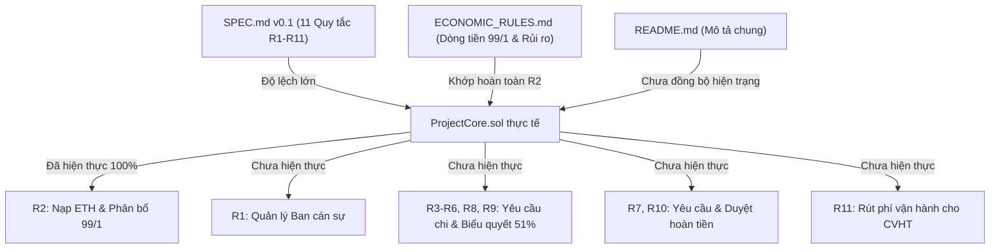

# TÀI LIỆU GATE REVIEW 1: DUYỆT CODEBASE VÀ PHẠM VI DỰ ÁN
**Môn học:** ECO2432 – Tiền điện tử & Hợp đồng thông minh  
**Dự án:** KTS-Class-Fund (Hệ thống Quản lý Quỹ lớp Ngành Kinh tế Số)  
**Thời điểm rà soát:** Cổng kiểm duyệt Gate Review 1 (Sau Lab 11, chuẩn bị cho Lab 13–15)  
**Người thực hiện rà soát:** Technical Lead & Reviewer nội bộ  
**Trạng thái thẩm định:** `CHỜ GIẢNG VIÊN XÁC NHẬN`

---

## 1. Thông tin dự án và Mục tiêu Gate Review 1

### 1.1. Thông tin dự án
- **Tên dự án:** KTS-Class-Fund
- **Mục tiêu sản phẩm:** Hợp đồng thông minh quản lý quỹ lớp phi tập trung cho sinh viên ngành Kinh tế Số (Trường Đại học Kinh tế – Đại học Huế), đảm bảo minh bạch dòng tiền nạp/chi, hỗ trợ trích phí vận hành mạng lưới và phân quyền dân chủ.
- **Thành viên nhóm ghi nhận trong tài liệu & Git:** 
  - Trần Hoàng Phương Dung (MSSV: 23K4300004, Git author: `thpdun`)
  - Võ Ngọc Tâm Phúc (MSSV: 23K4300015)

### 1.2. Mục tiêu Gate Review 1
- Đánh giá sức khỏe tổng thể của repository từ Lab 8 đến Lab 11.
- Đối chiếu tính nhất quán giữa tài liệu đặc tả ([docs/SPEC.md](file:///d:/document/TDT/KTS-Class-Fund-K57/docs/SPEC.md), [docs/ECONOMIC_RULES.md](file:///d:/document/TDT/KTS-Class-Fund-K57/docs/ECONOMIC_RULES.md)), tài liệu giới thiệu ([README.md](file:///d:/document/TDT/KTS-Class-Fund-K57/README.md)) và mã nguồn thực tế ([contracts/project/ProjectCore.sol](file:///d:/document/TDT/KTS-Class-Fund-K57/contracts/project/ProjectCore.sol)).
- Kiểm tra tính xác thực của các ca kiểm thử tự động, bằng chứng thực nghiệm (ảnh chụp, log chạy) của các ca hợp lệ, vi phạm và gian lận.
- Nhận diện các rủi ro kỹ thuật, phân định rõ phạm vi đã hoàn thành và phạm vi cần thu hẹp cho giai đoạn Lab 13–15.
- Đề xuất kết luận kỹ thuật nội bộ trước khi giảng viên đánh giá chính thức.

---

## 2. Phạm vi tài liệu và mã nguồn đã kiểm tra

Quá trình Gate Review 1 đã rà soát toàn diện các tệp sau trong repo:
1. **Quy ước & Hướng dẫn kỹ thuật:**
   - [AGENTS.md](file:///d:/document/TDT/KTS-Class-Fund-K57/AGENTS.md): Bộ quy ước lập trình Solidity `^0.8.20`, CEI, custom errors, basis points và tiêu chuẩn Python.
   - [prompt_templates.md](file:///d:/document/TDT/KTS-Class-Fund-K57/prompt_templates.md): Mẫu câu lệnh kiểm thử, thẩm định và đối chiếu nghiệp vụ.
2. **Tài liệu đặc tả & Kế hoạch:**
   - [README.md](file:///d:/document/TDT/KTS-Class-Fund-K57/README.md): Giới thiệu dự án, vai trò người dùng và cấu trúc kho khởi đầu.
   - [docs/SPEC.md](file:///d:/document/TDT/KTS-Class-Fund-K57/docs/SPEC.md): Đặc tả nghiệp vụ v0.1 (Nguồn yêu cầu chính thức hiện hành).
   - [docs/ECONOMIC_RULES.md](file:///d:/document/TDT/KTS-Class-Fund-K57/docs/ECONOMIC_RULES.md): Quy tắc kinh tế, dòng tiền 99/1, khuyến khích và rủi ro thiệt hại.
   - [SPEC.md](file:///d:/document/TDT/KTS-Class-Fund-K57/SPEC.md): Tệp mẫu khung rỗng ở thư mục gốc (không dùng làm nguồn yêu cầu).
   - [docs/PROJECT_PLAN.md](file:///d:/document/TDT/KTS-Class-Fund-K57/docs/PROJECT_PLAN.md): Kế hoạch dự án và phân kỳ các mốc Lab 13–15 (tạo mới trong đợt review này).
3. **Mã nguồn hợp đồng:**
   - [contracts/project/ProjectCore.sol](file:///d:/document/TDT/KTS-Class-Fund-K57/contracts/project/ProjectCore.sol): Hợp đồng thông minh lõi của dự án.
   - Các hợp đồng mẫu/training: `ClubTokens.sol`, `ClassPoint.sol`, `TimeLockVault.sol`, `VaultBuggy.sol`, `VulnerableBank.sol`.
4. **Kiểm thử & Bằng chứng thực tế:**
   - [test/test_economic_rules.py](file:///d:/document/TDT/KTS-Class-Fund-K57/test/test_economic_rules.py): Bộ kiểm thử tự động Python 5 ca kiểm thử kinh tế.
   - [test/ProjectCore_test.sol](file:///d:/document/TDT/KTS-Class-Fund-K57/test/ProjectCore_test.sol): Bộ kiểm thử đơn vị Solidity cho Remix IDE.
   - [evidence/lab-11/BaoCaoKiemThu_Lab11.md](file:///d:/document/TDT/KTS-Class-Fund-K57/evidence/lab-11/BaoCaoKiemThu_Lab11.md): Báo cáo kết quả kiểm thử Lab 11.
   - Ảnh chụp thực nghiệm: `thực thi thành công nạp 1eth vào ví và chia phí giao dịch.png`, `thất bại do nạp 0eth.png`.
   - Bằng chứng các Lab trước: `evidence/lab10/` (Audit VaultBuggy, lỗi receive), `evidence/` (TimeLockVault).
5. **Nhật ký AI & Lịch sử phiên bản:**
   - [docs/AI_JOURNAL.md](file:///d:/document/TDT/KTS-Class-Fund-K57/docs/AI_JOURNAL.md): Nhật ký làm việc với AI từ Lab 8 đến Lab 11.
   - Lịch sử Git: 5 commit từ `8d7037f` đến `efbda6b`.

---

## 3. Bảng kiểm tra sức khỏe Repo (Repository Health Check)

| Hạng mục kiểm tra | Tiêu chí đánh giá | Trạng thái | Bằng chứng cụ thể | Vấn đề cần xử lý / Ghi chú |
| :--- | :--- | :---: | :--- | :--- |
| **README.md** | Mô tả bài toán & giá trị thực tế | **ĐẠT** | Nêu rõ giải quyết minh bạch thu chi quỹ lớp Kinh tế Số K57. | Đã rõ ràng mục đích. |
| **README.md** | Nhận diện vai trò người dùng | **ĐẠT** | Phân định 3 vai trò: Cố vấn học tập (CVHT), Ban cán sự (BCS), Sinh viên. | Đầy đủ vai trò theo SPEC. |
| **README.md** | Khớp với hiện trạng mã nguồn | **ĐẠT** | Đã phân định rõ: (1) Tính năng đã triển khai trong `ProjectCore.sol` (R2 nạp ETH, 99/1 basis points, `ZeroAmount`, events, getters), (2) Tính năng chưa triển khai (biểu quyết 51%, thời hạn 7 ngày, hoàn tiền, phân quyền BCS, rút phí), (3) Lộ trình v0.1 và v0.2. Nêu rõ chưa deploy Sepolia. | - **Nguyên nhân cũ:** README ban đầu viết theo tầm nhìn tổng thể, gây hiểu nhầm tính năng đã chạy.<br>- **Hướng xử lý:** Đã rà soát và cấu trúc lại toàn diện Mục 2 README.md khớp 100% với mã nguồn hiện tại.<br>- **Kết quả:** Đã giải quyết hoàn tất trong **Lab 12**. |
| **README.md** | Hướng dẫn chạy và kiểm thử | **ĐẠT** | Mục 3 README.md cung cấp hướng dẫn chi tiết từng bước: (1) Chạy test Python (`python test/test_economic_rules.py` pass 5/5), (2) Chạy test Solidity trên Remix VM (`test/ProjectCore_test.sol` qua plugin Solidity Unit Testing pass 4/4), (3) Kiểm tra biên dịch Solc. Kèm bảng đối chiếu Expected vs Observed. | - **Nguyên nhân cũ:** Thiếu hướng dẫn cụ thể cho bộ test Python và test Solidity của Lab 11.<br>- **Hướng xử lý:** Đã bổ sung hướng dẫn chạy thực tế, điều kiện môi trường, cách nhận biết thành công/thất bại và giới hạn kiểm chứng.<br>- **Kết quả:** Đã giải quyết hoàn tất trong **Lab 12**. |
| **Tính nhất quán tài liệu** | Nguồn yêu cầu hiện hành | **ĐẠT** | `docs/SPEC.md` và `docs/ECONOMIC_RULES.md` là nguồn đặc tả thống nhất; `ProjectCore.sol` bám sát R2. | Thư mục gốc có file mẫu `SPEC.md` rỗng cần ghi chú tránh nhầm lẫn. |
| **Tính nhất quán tài liệu** | Khoảng cách giữa SPEC và Code | **CHƯA ĐẠT** | `SPEC.md` đặc tả 11 quy tắc (R1–R11), hợp đồng `ProjectCore.sol` mới chỉ hiện thực quy tắc R2 (thiếu 10 quy tắc). | - **Nguyên nhân:** Phạm vi đặc tả v0.1 ban đầu quá rộng so với thời lượng thực hành từng Lab.<br>- **Hướng xử lý:** Nhóm thống nhất **GIỮ NGUYÊN biểu quyết dân chủ $\ge 51\%$ (R4, R5)** và luồng đề xuất/giải ngân (R3, R6) là cốt lõi v0.1; bổ sung trường hợp **hoàn tiền an toàn nộp nhầm (R7)** ở Lab 14; tinh giản/hoãn các tính năng phụ trợ không bắt buộc: hoãn mã băm IPFS CID, hoãn cơ chế dọn dẹp hàng đợi đa trạng thái phức tạp, loại bỏ proxy voting.<br>- **Lab dự kiến xử lý:** **Lab 13** (R1, R11, R3, R4, R5, R6) và **Lab 14** (Hoàn tiền an toàn R7). |
| **Hợp đồng ProjectCore** | Chuẩn Solidity & Biên dịch | **ĐẠT** | Sử dụng `pragma solidity ^0.8.20;`, biên dịch sạch sẽ bằng `solc 0.8.37` (Exit code 0, 0 warning, 0 error). | Biên dịch đạt chuẩn hoàn hảo. |
| **Hợp đồng ProjectCore** | Quy tắc kinh tế R2 (99% / 1%) | **ĐẠT** | Áp dụng Basis Points (`FEE_BPS = 100`, `BPS_DENOMINATOR = 10_000`), phân bổ số nguyên, bảo toàn tổng tiền. | Đã xác minh qua kiểm thử tự động và thực nghiệm. |
| **Hợp đồng ProjectCore** | Kiến trúc an toàn & CEI | **ĐẠT** | Checks (`ZeroAmount`), Effects (`studentContributions`, `classFundBalance`, `adminFeePool`), phát đầy đủ events. Không dùng `tx.origin`. | Luồng nạp tuân thủ nghiêm ngặt CEI. |
| **Hợp đồng ProjectCore** | Kênh nạp & Rút tiền | **CHƯA ĐẠT** | Hỗ trợ 2 kênh nạp (`deposit`, `receive`) qua hàm nội bộ `_processDeposit`. Nhưng **chưa có hàm rút phí R11** (`withdrawAdminFee`). | - **Nguyên nhân:** Lab 11 chỉ tập trung quy tắc nạp R2 để giữ phạm vi nâng cấp tối thiểu, chưa xây dựng luồng rút tiền.<br>- **Hướng xử lý:** Xây dựng hàm `withdrawAdminFee(uint256 amount)` có modifier `onlyAdvisor`, phát sự kiện `AdminFeeWithdrawn` theo CEI.<br>- **Lab dự kiến xử lý:** **Lab 13** (Phân quyền & Rút phí vận hành). |
| **Kiểm thử & Bằng chứng** | Ca kiểm thử hợp lệ (Nạp 1 ETH) | **ĐẠT** | Quỹ lớp tăng 0.99 ETH, `adminFeePool` tăng 0.01 ETH, đóng góp tăng 1 ETH. Có ảnh Remix VM và test Python pass. | Bằng chứng xác thực tại `evidence/lab-11/`. |
| **Kiểm thử & Bằng chứng** | Ca kiểm thử vi phạm (Nạp 0 ETH) | **ĐẠT** | Revert đúng custom error `ZeroAmount()`, không lưu trạng thái rác. Có ảnh Remix VM và test Python pass. | Bằng chứng xác thực tại `evidence/lab-11/`. |
| **Kiểm thử & Bằng chứng** | Ca nạp trực tiếp & số nguyên | **ĐẠT** | Kênh `receive()` chia đúng tỷ lệ; nạp 99 wei phí 0 wei, quỹ 99 wei, không lệch tổng tiền. | Đạt chuẩn bảo toàn số dư. |
| **Kiểm thử & Bằng chứng** | Ca kiểm thử gian lận (Fraud) | **ĐẠT** | Thử nghiệm 0 ETH và 8 giá trị biên phức tạp, chặn đứng gian lận lịch sử và khai thác làm tròn. | Đạt quy ước tối thiểu 1 ca gian lận của `AGENTS.md`. |
| **Lịch sử Git** | Tính liên tục & Truy vết đóng góp | **ĐẠT** | Nhánh `main`, working tree sạch, 5 commit. | |

---

## 4. Kết quả Biên dịch và Kiểm thử Thực tế

### 4.1. Biên dịch mã nguồn (Compilation)
- **Công cụ:** `npx solc` (phiên bản `0.8.37+commit.f401782d.Emscripten.clang`).
- **Lệnh thực thi:**
  ```powershell
  npx solc --bin --abi contracts/project/ProjectCore.sol
  npx solc --bin --abi test/ProjectCore_test.sol
  ```
- **Kết quả:** Cả hai hợp đồng biên dịch thành công tuyệt đối, mã thoát `0`, không có lỗi cú pháp, không có cảnh báo kiểu dữ liệu hoặc deprecated.

### 4.2. Kiểm thử tự động (Automated Testing)
- **Công cụ:** Python 3.13 (`unittest` runner).
- **Lệnh thực thi:**
  ```powershell
  python test/test_economic_rules.py
  ```
- **Kết quả thực tế:**
  ```text
  Ran 5 tests in 0.001s
  OK
  [Ca 1 - Thành công]: Nạp 1.0000 ETH -> Quỹ lớp: 0.9900 ETH | Phí vận hành: 0.0100 ETH
  [Ca 2 - Chặn vi phạm]: Nạp 0 ETH -> Bị chặn bởi ZeroAmount, không lưu vết số dư rác
  [Ca 3 - Nạp trực tiếp receive()]: Nạp 0.5000 ETH -> Quỹ lớp: 0.4950 ETH | Phí: 0.0050 ETH
  [Ca 4 - Phép chia số nguyên]: Nạp 99 wei -> Phí: 0 wei | Quỹ lớp: 99 wei (Bảo toàn 100%)
  [Ca 5 - Chống gian lận]: Chặn nạp 0 ETH tạo lịch sử ảo; bảo toàn số dư trên 8 giá trị biên
  ```

### 4.3. Đối chiếu bằng chứng hình ảnh (Remix VM Verification)
- File `evidence/lab-11/thực thi thành công nạp 1eth vào ví và chia phí giao dịch.png`: Xác nhận giao dịch nạp 1 ETH thành công trên Remix VM, biến `classFundBalance` hiển thị `990000000000000000`, `adminFeePool` hiển thị `10000000000000000`, `studentContributions` hiển thị `1000000000000000000`.
- File `evidence/lab-11/thất bại do nạp 0eth.png`: Xác nhận giao dịch gửi 0 ETH bị reverted trên Remix VM với thông báo lỗi `custom error ZeroAmount()`.

---

## 5. Đánh giá sự nhất quán giữa Tài liệu và Mã nguồn



1. **Điểm nhất quán cao (Khớp 100%):**
   - Quy tắc **R2**: Cả SPEC, ECONOMIC_RULES và ProjectCore đều thống nhất tỷ lệ trích 1% (100 basis points) vào `adminFeePool` và 99% vào Quỹ lớp chính.
   - Cơ chế ghi nhận đóng góp: Hợp đồng ghi nhận đúng 100% số tiền gốc thực tế của sinh viên vào `studentContributions` làm căn cứ giới hạn hoàn tiền.
   - Quy tắc an toàn: Không dùng floating point, xử lý làm tròn số nguyên không thất thoát wei.
2. **Khoảng cách cần xử lý (Discrepancy / Scope Gap):**
   - `SPEC.md` đặt ra kỳ vọng rất lớn với 11 quy tắc (hệ thống biểu quyết phân tán 51%, khóa thời gian 7 ngày, quy trình nộp minh chứng IPFS hoàn tiền).
   - Mã nguồn `ProjectCore.sol` tính đến hết Lab 11 mới chỉ hoàn thành duy nhất chức năng nạp tiền (R2). Toàn bộ luồng chi tiêu, biểu quyết và hoàn tiền chưa hề có trong hợp đồng.
   - Nếu giữ nguyên toàn bộ 11 quy tắc cho các bài thực hành còn lại (Lab 13–15), nguy cơ vỡ tiến độ hoặc hợp đồng vượt giới hạn kích thước bytecode (Spurious Dragon limit) là rất cao.

---

## 6. Các rủi ro và Vấn đề kỹ thuật ưu tiên cao

1. **Rủi ro kẹt quỹ phí vận hành (Medium Severity):**
   - Hiện tại, `adminFeePool` đã tích lũy ETH từ các khoản nạp của sinh viên, nhưng hợp đồng chưa có bất kỳ hàm nào (như `withdrawAdminFee()`) để Cố vấn học tập rút số ETH này ra ví cá nhân nhằm bù đắp gas.
   - *Biện pháp:* Bắt buộc triển khai hàm rút phí có kiểm tra quyền `onlyAdvisor` trong Lab 13.
2. **Rủi ro thiếu cơ chế quản trị nhân sự on-chain (Medium Severity):**
   - Biến `advisor` được gán cố định `msg.sender` trong `constructor` và là `immutable`. Nếu mất khóa riêng tư (Private Key) của ví này, toàn bộ quyền quản trị trong tương lai sẽ bị khóa vĩnh viễn (đã được ghi nhận trong `ECONOMIC_RULES.md` mục 4 nhưng cần lưu ý).
3. **Rủi ro phình to phạm vi (Scope Creep Risk - High Severity):**
   - Kế hoạch ban đầu của SPEC bao gồm nhiều tính năng mở rộng: xử lý mã băm IPFS cho hoàn tiền, cơ chế tự động dọn dẹp hàng đợi quá hạn đa trạng thái, ủy quyền biểu quyết. Triển khai toàn bộ các cơ chế này trong thời gian ngắn dễ dẫn đến lỗi Reentrancy, nghẽn Gas hoặc không kịp hoàn thiện giao diện DApp ở Lab 15.
   - *Biện pháp giảm thiểu:* Giữ trọn vẹn giá trị cốt lõi là **Biểu quyết dân chủ $\ge 51\%$ (R4, R5)** và luồng giải ngân (R3, R6) cùng **trường hợp hoàn tiền an toàn (R7)**; đồng thời kiên quyết hoãn/cắt bỏ các thành phần thứ cấp (mã băm IPFS, proxy voting, dọn dẹp hàng đợi phức tạp).

---

## 7. Ba việc cần sửa hoặc xác minh tiếp theo (Xếp theo thứ tự ưu tiên)

1. **Ưu tiên 1 (Kỹ thuật - Triển khai Phân quyền, Rút phí & Luồng Biểu quyết cốt lõi Lab 13):**
   - Cài đặt hàm `withdrawAdminFee(uint256 amount)` có modifier `onlyAdvisor` để CVHT giải phóng ETH phí vận hành trong `adminFeePool` (R11).
   - Cài đặt hàm quản lý Ban cán sự `setBCSMember(address, bool)` của CVHT (R1).
   - Xây dựng cấu trúc đề xuất chi và **cơ chế biểu quyết dân chủ $\ge 51\%$** của Ban cán sự (R3, R4, R5, R6) theo đúng tinh thần cốt lõi của dự án: BCS tạo đề xuất $\rightarrow$ BCS bỏ phiếu $\rightarrow$ kiểm tra ngưỡng $51\%$ và thời hạn 7 ngày $\rightarrow$ giải ngân qua `.call`.
2. **Ưu tiên 2 (Kỹ thuật & Nghiệp vụ - Thẩm định và thiết kế luồng Hoàn tiền an toàn Lab 14):**
   - Thiết kế luồng hoàn tiền nộp nhầm an toàn: Kiểm tra điều kiện kép `amount <= studentContributions[msg.sender]` và `amount <= classFundBalance`.
   - Chốt câu hỏi nghiệp vụ về tác động của R2: Khi hoàn tiền, sinh viên nhận $99\%$ (tự chịu $1\%$ phí vận hành) hay nhận $100\%$ (Quỹ lớp hoặc CVHT bù $1\%$).
3. **Ưu tiên 3 (Phạm vi - Tinh giản các tính năng phụ trợ không bắt buộc):**
   - Hoãn tích hợp mã băm IPFS CID phức tạp trên chuỗi (theo Mục 6 SPEC đã xác định lưu file vật lý là ngoài phạm vi).
   - Tinh giản cơ chế dọn dẹp quá hạn 7 ngày: Sử dụng kiểm tra điều kiện thời gian trực tiếp `block.timestamp <= createdAt + 7 days` thay vì xây dựng hệ thống tác vụ ngầm phức tạp.

---

## 8. Đề xuất điều chỉnh phạm vi sản phẩm (Scope Recommendation)

Căn cứ quan điểm của nhóm (biểu quyết là giá trị cốt lõi không thể cắt bỏ, mong muốn có hoàn tiền an toàn) và đánh giá khả thi kỹ thuật:

| Tính năng / Quy tắc | Hiện trạng trong Code | Đề xuất Gate Review 1 | Lý do điều chỉnh & Đánh giá khả thi |
| :--- | :---: | :---: | :--- |
| **R2: Nạp ETH & trích phí 1%** | Đã xong (Lab 11) | **GIỮ NGUYÊN** | Đã hoàn thiện, chạy ổn định, có test tự động và bằng chứng thực tế. |
| **R11: Rút phí vận hành adminFeePool** | Chưa có | **GIỮ LẠI (LÀM TRONG LAB 13)** | Hoàn thiện chu trình của dòng tiền phí dịch vụ đã trích ở R2. |
| **R1: Thêm/xóa thành viên Ban cán sự** | Chưa có | **GIỮ LẠI (LÀM TRONG LAB 13)** | Cần thiết để xác định danh sách tài khoản có thẩm quyền biểu quyết. |
| **R3, R4, R5, R6: Đề xuất chi, Biểu quyết $\ge 51\%$ & Giải ngân** | Chưa có | **GIỮ LẠI (CỐT LÕI V0.1)** | **Không cắt bỏ biểu quyết.** Xây dựng luồng tối thiểu: Thành viên BCS tạo đề xuất $\rightarrow$ BCS bỏ phiếu $\rightarrow$ Kiểm tra đạt $\ge 51\%$ và thời hạn 7 ngày $\rightarrow$ Thực thi giải ngân qua `.call`. |
| **R7, R10: Yêu cầu & Phê duyệt Hoàn tiền (Đơn vị nộp nhầm)** | Chưa có | **XEM XÉT ĐƯA VÀO V0.1 (TINH GIẢN)** | Đưa vào trường hợp hoàn tiền nộp nhầm an toàn: Kiểm tra `refundAmount <= studentContributions` và `<= classFundBalance`. Tạm hoãn cơ chế bỏ phiếu hoàn tiền nhiều vòng, ưu tiên CVHT/BCS phê duyệt trực tiếp. |
| **Lưu trữ mã băm IPFS CID (`proofHash`)** | Chưa có | **CHUYỂN SANG V0.2 / LOẠI BỎ** | Mục 6 SPEC quy định lưu trữ file vật lý là ngoài phạm vi; việc tích hợp upload IPFS gây cản trở lớn cho frontend Lab 15. |
| **Cơ chế tự động dọn dẹp hết hạn 7 ngày phức tạp (R9)** | Chưa có | **TINH GIẢN CHO V0.1** | Thay vì tạo hàm dọn dẹp đa trạng thái, hợp đồng kiểm tra trực tiếp điều kiện thời gian `block.timestamp <= createdAt + 7 days` tại thời điểm gọi giải ngân. |
| **Cơ chế ủy quyền biểu quyết (Proxy Voting) / Phân bổ trọng số** | Chưa có | **LOẠI BỎ KHỎI V0.1** | Đã thuộc mục Ngoài phạm vi của SPEC. |
| **Hỗ trợ ERC-20 Token / Tiền pháp định (Fiat)** | Chưa có | **CHUYỂN SANG V0.2** | Giữ v0.1 thuần túy giao dịch bằng Sepolia ETH. |

---

## 9. Kế hoạch và Người phụ trách (Cần nhóm xác nhận)

| Mốc thực hiện | Nhiệm vụ chính | Đầu ra dự kiến | Người phụ trách | Hạn hoàn thành |
| :--- | :--- | :--- | :---: | :---: |
| **Lab 12** | Gate Review 1, kiểm tra sức khỏe repo, cập nhật kế hoạch | `GATE_REVIEW_1.md`, `PROJECT_PLAN.md`, `AI_JOURNAL.md` | Trần Hoàng Phương Dung (`thpdun`) | Hoàn thành |
| **Lab 13** | Hoàn thiện phân quyền CVHT (R1), rút phí vận hành (R11), Đề xuất chi & Biểu quyết $\ge 51\%$ (R3, R4, R5, R6) | `ProjectCore.sol` nâng cấp, test phân quyền & biểu quyết | Trần Hoàng Phương Dung, Võ Ngọc Tâm Phúc | 23/10/2026 |
| **Lab 14** | Triển khai luồng Hoàn tiền an toàn (R7), Kiểm thử tích hợp toàn bộ luồng (Nạp - Biểu quyết - Chi - Hoàn - Rút), đo lường tối ưu Gas | Bộ test tích hợp, bảng đo lường Gas | Trần Hoàng Phương Dung, Võ Ngọc Tâm Phúc | 24/10/2026 |
| **Lab 15** | Kết nối DApp Frontend, tương tác MetaMask trên Sepolia | Giao diện web hoàn chỉnh, video demo | Trần Hoàng Phương Dung, Võ Ngọc Tâm Phúc | 25/10/2026 |

---

## 10. Kết luận Gate Review 1

### 10.1. Đề xuất kỹ thuật nội bộ của Nhóm / Reviewer
- **Đánh giá sơ bộ:** **QUA CÓ ĐIỀU KIỆN (CONDITIONAL PASS)**
- **Căn cứ đề xuất:**
  - Codebase hiện tại đáp ứng chuẩn mực kỹ thuật cao (Solidity `^0.8.20`, Checks-Effects-Interactions, custom error, basis points, không có lỗi biên dịch).
  - Quy tắc kinh tế R2 đã được cài đặt và kiểm chứng bằng cả kiểm thử tự động Python lẫn thực nghiệm Remix VM với bằng chứng rõ ràng.
  - Điều kiện cần giải quyết: Nhóm thống nhất giữ cơ chế biểu quyết dân chủ $\ge 51\%$ (R4, R5) là tính năng cốt lõi cho v0.1 và xem xét đưa vào luồng hoàn tiền an toàn (R7); tinh giản các tính năng phụ trợ (IPFS, đa trạng thái dọn dẹp quá hạn) và xin ý kiến Giảng viên phê duyệt phạm vi điều chỉnh trước khi bước vào triển khai Lab 13.


### 10.2. Quyết định chính thức của Giảng viên hướng dẫn môn học ECO2432
> **TRẠNG THÁI HIỆN TẠI: `CHỜ GIẢNG VIÊN XÁC NHẬN`**

*(Khu vực dành cho Giảng viên ghi nhận nhận xét, phê duyệt kết luận và quyết định phạm vi chính thức trong buổi review trên lớp)*

- **Kết luận của Giảng viên:** `[ ] Qua` &nbsp;&nbsp;&nbsp;&nbsp; `[ ] Qua có điều kiện` &nbsp;&nbsp;&nbsp;&nbsp; `[ ] Thu hẹp phạm vi`
- **Các yêu cầu hoặc điều chỉnh cụ thể từ Giảng viên:**
  - *Yêu cầu 1:* ............................................................................................................
  - *Yêu cầu 2:* ............................................................................................................
  - *Yêu cầu 3:* ............................................................................................................
- **Chữ ký / Xác nhận của Giảng viên:** ..................................................... **Ngày:** ..../..../2026
