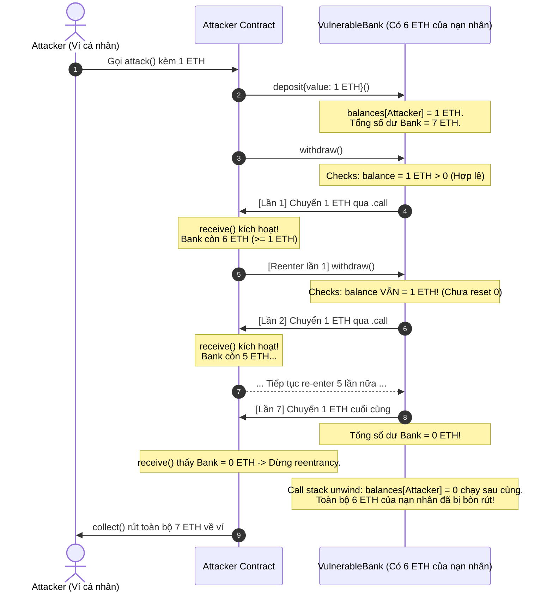

# BÁO CÁO THỰC NGHIỆM LAB 13 — VỤ MẤT TIỀN VÀ HOÀN THIỆN PROJECTCORE
**Môn học:** ECO2432 – Tiền điện tử & Hợp đồng thông minh  
**Dự án:** KTS-Class-Fund (Quản lý Quỹ lớp Ngành Kinh tế Số)  
**Chủ đề:** Thực nghiệm tấn công Reentrancy, phân tích CEI vs ReentrancyGuard, hoàn thiện triển khai R1–R11 trong `ProjectCore.sol` và kiểm thử toàn diện.  
**Ngày thực hiện:** 21/10/2026 (Cập nhật rà soát: 22/10/2026)  
**Thành viên thực hiện:** 
- Trần Hoàng Phương Dung (MSSV: 23K4300004) - Trưởng nhóm / Smart Contract Developer
- Võ Ngọc Tâm Phúc (MSSV: 23K4300015) - Thành viên QA / Tester

---

## 1. Giới thiệu bài thực nghiệm Lab 13

Theo sổ tay thực hành ECO2432 và kế hoạch dự án, Lab 13 bao gồm hai nội dung cốt lõi:
1. **Phân tích và thực nghiệm lỗ hổng tái nhập (Reentrancy Attack):** Khảo sát nguyên nhân gốc rễ trên [contracts/training/VulnerableBank.sol](file:///d:/document/TDT/KTS-Class-Fund-K57/contracts/training/VulnerableBank.sol), so sánh giải pháp Checks-Effects-Interactions (CEI) với `ReentrancyGuard`, và kiểm chứng cơ chế phòng vệ của [test/VulnerableBank_test.sol](file:///d:/document/TDT/KTS-Class-Fund-K57/test/VulnerableBank_test.sol) (`FixedBank`).
2. **Hoàn thiện triển khai hợp đồng thông minh [contracts/project/ProjectCore.sol](file:///d:/document/TDT/KTS-Class-Fund-K57/contracts/project/ProjectCore.sol):** Triển khai đầy đủ các chức năng theo đặc tả nghiệp vụ [docs/SPEC.md](file:///d:/document/TDT/KTS-Class-Fund-K57/docs/SPEC.md) bao gồm R1 (Phân quyền CVHT & Ban cán sự), R2 (Nạp quỹ 99/1), R11 (Rút phí vận hành), R3 (Tạo đề xuất chi & giữ chỗ số dư), R4/R5 (Biểu quyết dân chủ $\ge 51\%$, chống bỏ phiếu kép, thời hạn 7 ngày), R6 (Giải ngân an toàn qua `.call` tuân thủ CEI).
3. **Xây dựng bộ kiểm thử tự động:**
   - **Solidity Unit Test:** 27 hàm kiểm thử trong [test/ProjectCore_test.sol](file:///d:/document/TDT/KTS-Class-Fund-K57/test/ProjectCore_test.sol) phân bổ qua 7 nhóm kiểm thử (A đến G), thiết kế cho Remix Solidity Unit Testing.
   - **Python Unit Test:** 15 ca kiểm thử kinh tế tự động trong [test/test_economic_rules.py](file:///d:/document/TDT/KTS-Class-Fund-K57/test/test_economic_rules.py).

---

## 2. Phân tích nguyên nhân gốc rễ Reentrancy & So sánh CEI vs ReentrancyGuard

### 2.1. Mã nguồn có lỗ hổng trong `VulnerableBank.sol`
```solidity
function withdraw() external {
    uint256 balance = balances[msg.sender];
    require(balance > 0, "Khong co so du");          // [1] Checks

    (bool ok, ) = msg.sender.call{value: balance}(""); // [2] Interactions (TRƯỚC KHI CẬP NHẬT TRẠNG THÁI!)
    require(ok, "Chuyen that bai");

    balances[msg.sender] = 0;                         // [3] Effects (QUÁ MUỘN!)
}
```

### 2.2. Cơ chế bòn rút tiền của Attacker
1. **Lỗi đảo lộn trật tự CEI:** Hợp đồng thực hiện chuyển ETH (`Interactions`) tới `msg.sender` thông qua lệnh gọi cấp thấp `.call` **TRƯỚC KHI** trừ số dư của người dùng (`balances[msg.sender] = 0`).
2. **Kích hoạt hàm nhận tiền của Attacker:** Khi `msg.sender` là một hợp đồng thông minh (`Attacker`), lệnh gọi `.call` sẽ kích hoạt hàm `receive()` hoặc `fallback()` của `Attacker`.
3. **Đòn tái nhập (Re-entering):** Tại thời điểm hàm `receive()` của Attacker được gọi, biến trạng thái `balances[Attacker]` trong `VulnerableBank` **vẫn chưa bị đặt về 0**. Vì vậy, Attacker có thể tiếp tục gọi lại `bank.withdraw()`.
4. **Hậu quả:** `VulnerableBank` kiểm tra lại `require(balance > 0)` và vẫn thấy số dư cũ, tiếp tục gửi thêm ETH cho Attacker. Quá trình này lặp đi lặp lại dạng đệ quy cho đến khi số dư trong ngân hàng bị rút cạn về 0 ETH.



### 2.3. So sánh Checks-Effects-Interactions (CEI) vs ReentrancyGuard

| Tiêu chí | Mô hình Checks - Effects - Interactions (CEI) | Cơ chế Khóa ReentrancyGuard (Mutex) |
| :--- | :--- | :--- |
| **Nguyên lý hoạt động** | Cập nhật toàn bộ biến trạng thái nội bộ (`Effects`) **trước khi** thực hiện bất kỳ lệnh gọi tương tác ngoại vi (`Interactions`) nào. | Sử dụng biến trạng thái làm cờ khóa (flag: 1 = Chưa vào, 2 = Đang thực thi) để từ chối mọi cuộc gọi lồng nhau vào hàm có gắn modifier `nonReentrant`. |
| **Chi phí Gas tiêu thụ** | **Tối ưu nhất (Rẻ nhất)**: Không phát sinh thêm thao tác ghi/đọc bộ nhớ (`SSTORE`/`SLOAD`) cho cờ khóa. | **Tốn Gas hơn**: Mỗi giao dịch phải tốn thêm Gas cho 2 thao tác `SSTORE` (khóa cờ khi vào hàm và mở cờ khi kết thúc hàm). |
| **Tính phụ thuộc thư viện** | **Không phụ thuộc**: Là quy chuẩn thiết kế tư duy lập trình thuần túy, áp dụng trực tiếp trong mã Solidity. | **Cần thư viện**: Thường phải kế thừa từ `ReentrancyGuard.sol` của OpenZeppelin. |
| **Phạm vi bảo vệ** | Bảo vệ tuyệt đối đối với Reentrancy đơn hàm (Single-function Reentrancy) và ngăn chặn việc khai thác trạng thái cũ. | Bảo vệ được cả Reentrancy đa hàm (Cross-function Reentrancy) nếu nhiều hàm cùng chia sẻ chung modifier. |
| **Khuyến nghị theo AGENTS.md** | **BẮT BUỘC (Quy tắc 3)**: Đây là tiêu chuẩn vàng của lập trình Web3 và là tư duy bắt buộc của lập trình viên blockchain. | Bổ trợ khi hệ thống có cấu trúc gọi chéo đa hợp đồng phức tạp (không bắt buộc với dự án lớp). |

---

## 3. Bảng đối chiếu yêu cầu và Hiện trạng triển khai `ProjectCore.sol`

| Mã yêu cầu | Chức năng cần có | Hiện trạng mã nguồn | File/hàm liên quan | Đánh giá & Phân định phạm vi SPEC |
| :---: | :--- | :---: | :--- | :--- |
| **R1** | Phân quyền Cố vấn học tập (CVHT) và Quản trị Ban cán sự (BCS) | **ĐÃ TRIỂN KHAI** | [contracts/project/ProjectCore.sol](file:///d:/document/TDT/KTS-Class-Fund-K57/contracts/project/ProjectCore.sol)<br/>- `modifier onlyAdvisor`<br/>- `setBCSMember(...)` | Khớp SPEC: Chỉ CVHT đổi được BCS; chặn địa chỉ zero; người ngoài bị từ chối; BCS vô hiệu hóa bị tước quyền. |
| **R2** | Nạp tiền vào quỹ, phân bổ 99% Quỹ lớp, 1% Quỹ phí vận hành | **ĐÃ TRIỂN KHAI** | [contracts/project/ProjectCore.sol](file:///d:/document/TDT/KTS-Class-Fund-K57/contracts/project/ProjectCore.sol)<br/>- `deposit()`<br/>- `receive()`<br/>- `_processDeposit(...)` | Khớp SPEC: Tách 99% vào `classFundBalance` và 1% vào `adminFeePool`, custom error `ZeroAmount()`, ghi nhận `studentContributions`, bảo toàn số dư wei. |
| **R11** | Rút phí vận hành bù đắp chi phí Gas | **ĐÃ TRIỂN KHAI** | [contracts/project/ProjectCore.sol](file:///d:/document/TDT/KTS-Class-Fund-K57/contracts/project/ProjectCore.sol)<br/>- `withdrawAdminFee(...)` | Khớp SPEC: Chỉ CVHT rút được; không rút quá fee pool; chuyển ETH thất bại phải rollback; không xâm lấn Quỹ lớp. |
| **R3** | Tạo đề xuất chi tiêu quỹ lớp | **ĐÃ TRIỂN KHAI** | [contracts/project/ProjectCore.sol](file:///d:/document/TDT/KTS-Class-Fund-K57/contracts/project/ProjectCore.sol)<br/>- `createSpendRequest(...)` | Khớp SPEC: Chỉ BCS hoạt động được tạo; chặn recipient zero; chặn amount zero hoặc vượt quỹ khả dụng; giữ chỗ qua `reservedSpendAmount`. |
| **R4 & R5** | Bỏ phiếu đề xuất chi, chống bỏ phiếu kép, thời hạn 7 ngày, ngưỡng $\ge 51\%$ | **ĐÃ TRIỂN KHAI** | [contracts/project/ProjectCore.sol](file:///d:/document/TDT/KTS-Class-Fund-K57/contracts/project/ProjectCore.sol)<br/>- `voteSpendRequest(...)`<br/>- `expireSpendRequest(...)` | Bỏ phiếu YES/NO, chống double voting (`AlreadyVoted`), chặn quá hạn 7 ngày. <br/>*(Lưu ý: Mẫu số tính tỷ lệ và dọn dẹp giữ chỗ: xem mục 4 bên dưới - cần xác nhận).* |
| **R6** | Thực thi giải ngân cho đề xuất đủ điều kiện | **ĐÃ TRIỂN KHAI** | [contracts/project/ProjectCore.sol](file:///d:/document/TDT/KTS-Class-Fund-K57/contracts/project/ProjectCore.sol)<br/>- `executeSpendRequest(...)` | Khớp SPEC: Chỉ thực thi khi đạt 51%; chống thực thi kép; cập nhật `Executed` và trừ tiền TRƯỚC KHI `.call` (CEI); chuyển ETH thất bại rollback toàn bộ. |

---

## 4. Rà soát Logic Chuyên sâu & Các Điểm Cần Xác Nhận Với SPEC

### 4.1. Ngưỡng biểu quyết 51% và mẫu số Ban cán sự động
- **Công thức tính trong mã nguồn:**
  $$\text{approvalBps} = \frac{\text{yesVotes} \times 10000}{\text{activeBCSCount}}$$
  Đạt điều kiện khi: $\text{approvalBps} \ge 5100$ ($51\%$).
- **Điểm cần làm rõ đối chiếu SPEC:**
  - `SPEC.md` R4 quy định: *"đạt tỷ lệ đồng ý tối thiểu 51% (tương đương 5100 basis points) trên tổng số thành viên Ban cán sự tại thời điểm kiểm tra"*.
  - **Tình huống nghiệp vụ:** Nếu CVHT thêm hoặc bãi nhiệm thành viên BCS trong lúc một đề xuất đang ở trạng thái `Pending`:
    - Mã nguồn hiện tại tính động theo `activeBCSCount` tại thời điểm gọi hàm (`voteSpendRequest` hoặc `executeSpendRequest`). Nếu bãi nhiệm bớt BCS, mẫu số giảm, tỷ lệ đồng ý của các phiếu đã có sẽ tự động tăng lên. Ngược lại, nếu thêm BCS, tỷ lệ đồng ý có thể tạm thời rơi xuống dưới 51%.
    - **Kết luận:** Mã nguồn tuân thủ câu chữ "tại thời điểm kiểm tra" của SPEC. Tuy nhiên, việc có nên chốt cố định danh sách cử tri tại thời điểm tạo đề xuất (snapshot) hay không là **điểm cần xác nhận với Cố vấn học tập / Giảng viên**.

### 4.2. Trạng thái `Pending` và `Ready` trước khi giải ngân
- `SPEC.md` R4 nêu đề xuất tự động chuyển sang `Ready` khi đạt $\ge 51\%$, và R5 nêu chỉ có thể gọi thực thi giải ngân khi đã đạt tỷ lệ đồng ý tối thiểu 51%.
- Trong mã nguồn `ProjectCore.sol`:
  - Hàm `executeSpendRequest` cho phép thực thi nếu đề xuất đang ở trạng thái `Ready`.
  - Nếu đề xuất đang ở `Pending` nhưng tại thời điểm gọi giải ngân tỷ lệ phiếu thuận đã đạt $\ge 51\%$ (do biến động số lượng BCS), hợp đồng tự động xác nhận đủ điều kiện và chuyển sang `Executed`.
  - **Kết luận:** Đây là giải pháp xử lý linh hoạt của nhóm; việc đề xuất có bắt buộc phải chuyển trạng thái `Ready` qua một bước trung gian độc lập hay không là **điểm cần xác nhận với SPEC**.

### 4.3. Thời hạn 7 ngày, trạng thái `Expired` và giải phóng tiền giữ chỗ
- `SPEC.md` R5 nêu nếu sau 7 ngày không đạt 51% thì yêu cầu tự động hết hạn (`Expired`). `SPEC.md` R9 nêu bất kỳ ai cũng có thể gọi dọn dẹp quá hạn sau 7 ngày để giải phóng hệ thống cho yêu cầu chi mới.
- Trong mã nguồn `ProjectCore.sol`:
  - Hàm `expireSpendRequest(requestId)` cho phép dọn dẹp các đề xuất đã quá hạn 7 ngày (`block.timestamp > createdAt + 7 days`).
  - Hợp đồng cập nhật `status = Expired` và thực hiện `reservedSpendAmount -= req.amount`, giải phóng hạn mức giữ chỗ về lại số dư khả dụng (`getAvailableClassFund()`).
  - **Kết luận:** SPEC chỉ quy định việc dọn dẹp để cho phép tạo đề xuất mới, chưa đề cập chi tiết cơ chế hoàn trả số dư giữ chỗ trong kế toán. Nhóm đã chủ động bổ sung để bảo vệ tính khả dụng của quỹ lớp. Đây là **điểm đề xuất kỹ thuật cần xác nhận**.

### 4.4. Phân tích kiểm tra Reentrancy (Test F5): Phân quyền vs CEI
- **Mục tiêu kiểm thử bảo mật:** Đảm bảo đòn tấn công tái nhập bị chặn bởi **trạng thái đã thực thi (CEI)** chứ không phải do bị từ chối ở tầng phân quyền truy cập.
- **Phát hiện và cải tiến trong `test/ProjectCore_test.sol`:**
  - Nếu hợp đồng tấn công là địa chỉ bên ngoài thông thường, khi cố tình tái nhập vào `executeSpendRequest()`, giao dịch sẽ bị chặn ngay tại modifier `onlyActiveBCS` (báo lỗi `NotActiveBCS`). Điều này **không chứng minh được** mô hình CEI có hiệu quả hay không.
  - Nhóm đã xây dựng hợp đồng [MaliciousBCSRecipient](file:///d:/document/TDT/KTS-Class-Fund-K57/test/ProjectCore_test.sol#L80-L123) và chủ động cấp quyền BCS cho hợp đồng này qua lệnh:
    ```solidity
    core.setBCSMember(address(attackerRecipient), true);
    ```
  - Khi `executeSpendRequest` chuyển 1 ETH tới `attackerRecipient`, hàm `receive()` của kẻ tấn công gọi lại `core.executeSpendRequest(1)`.
  - **Đường đi thực thi được kiểm chứng:**
    1. Kiểm tra quyền `onlyActiveBCS`: **VƯỢT QUA** (vì `isBCSMember[attackerRecipient] == true`).
    2. Kiểm tra trạng thái đề xuất: Do dòng `req.status = RequestStatus.Executed` đã chạy trước lệnh `.call`, cuộc gọi tái nhập lập tức chạm phải kiểm tra:
       ```solidity
       if (req.status == RequestStatus.Executed) revert RequestAlreadyExecuted(requestId);
       ```
    3. Cuộc gọi tái nhập bị chặn đích xác bởi custom error selector:
       `bytes4(keccak256("RequestAlreadyExecuted(uint256)"))`.
  - **Kết luận:** Thử nghiệm chứng minh rõ ràng đòn tái nhập bị chặn bởi cơ chế CEI của hàm giải ngân, hoàn toàn không bị nhầm lẫn với lỗi phân quyền.

---

## 5. Kết quả Kiểm thử Tự động Python (`test/test_economic_rules.py`)

- **Công cụ:** Python 3.10+ (sử dụng thư viện chuẩn `unittest`).
- **Lệnh thực thi:**
  ```powershell
  python test/test_economic_rules.py
  ```
- **Kết quả thực tế quan sát được (15/15 ca ĐẠT trong 0.001s):**
  ```text
  ...............
  ----------------------------------------------------------------------
  Ran 15 tests in 0.001s

  OK

  [Ca 1 - Nạp 1 ETH thành công]: Quỹ chính 0.99 ETH, Quỹ phí 0.01 ETH, bảo toàn số dư.
  [Ca 2 - Chặn nạp 0 ETH]: Revert ZeroAmount() thành công.
  [Ca 3 - Kênh nạp trực tiếp receive()]: Phân bổ 99%/1% chuẩn xác.
  [Ca 4 - Phép chia số nguyên & bảo toàn wei]: 99 wei (phí 0), 101 wei (phí 1).
  [Ca 5 - Kiểm tra chống gian lận & giá trị biên]: 100% giá trị biên bảo toàn số dư.
  [Ca 6 - Negative Test: Kênh receive() nạp 0 ETH]: Revert ZeroAmount().
  [Ca 7 - Đánh giá an toàn CEI luồng nạp]: Bất biến số dư được bảo toàn.
  [Ca 8 - R1: Phân quyền CVHT & BCS]: Chỉ CVHT được thêm/xóa BCS, chặn outsider thành công.
  [Ca 9 - R11: Rút phí vận hành]: CVHT rút phí thành công, Quỹ lớp 9.9 ETH được bảo toàn 100%.
  [Ca 10 - R3: Tạo đề xuất chi]: BCS tạo hợp lệ, giữ chỗ 2 ETH, chặn người ngoài và chi vượt ngân sách.
  [Ca 11 - R4/R5: Biểu quyết]: 1/3 (Pending), chặn double-voting, 2/3 >= 51% (Ready), chặn quá hạn 7 ngày.
  [Ca 12 - R6: Giải ngân & Bất biến kế toán]: Giải ngân thành công, chặn double-spending, bảo toàn bất biến.
  [Ca 13 - R11: Rollback khi chuyển phí thất bại]: adminFeePool được bảo toàn nguyên vẹn.
  [Ca 14 - R3: Giữ chỗ đa đề xuất]: Ngăn chặn thành công việc nhiều đề xuất chi vượt ngân sách.
  [Ca 15 - R5/R9: Đánh dấu Expired giải phóng tiền giữ chỗ]: 4 ETH giữ chỗ được giải phóng về quỹ khả dụng.
  ```

---

## 6. Kết quả Kiểm thử Đơn vị Solidity (`test/ProjectCore_test.sol`)

### 6.1. Kiểm tra biên dịch mã nguồn (Solc Compilation)
- **Lệnh thực thi:**
  ```powershell
  npx solc --bin contracts/project/ProjectCore.sol test/ProjectCore_test.sol
  ```
- **Kết quả thực tế:** Trình biên dịch `solc 0.8.37` hoàn thành với mã thoát `0` (Exit code: 0). Hợp đồng chính `ProjectCore.sol` không có bất kỳ lỗi cú pháp hoặc cảnh báo nào. Cảnh báo dung lượng bytecode chỉ xuất hiện trên hợp đồng kiểm thử `ProjectCoreTest` (chứa toàn bộ kịch bản test cho Remix VM).

### 6.2. Cấu trúc 27 hàm kiểm thử Solidity trên Remix IDE
Tệp `test/ProjectCore_test.sol` chứa chính xác **27 hàm kiểm thử** được thiết kế riêng cho plugin **Solidity Unit Testing** của Remix IDE:

- **Nhóm A — R2: Nạp quỹ & Phân bổ 99/1 (4 hàm):**
  1. `testGroupA1_Deposit1ETH_Split99_1`: Nạp 1 ETH phân bổ chuẩn 0.99 ETH và 0.01 ETH.
  2. `testGroupA2_DirectReceive`: Nạp trực tiếp qua kênh `receive()`.
  3. `testGroupA3_ZeroAmountReverts`: Nạp 0 ETH qua `deposit()` và `receive()` đều revert `ZeroAmount()`.
  4. `testGroupA4_IntegerMathEdgeCases`: Phép tính số nguyên không làm thất thoát wei cho 99 wei và 101 wei.
- **Nhóm B — R1: Phân quyền CVHT & Quản trị BCS (4 hàm):**
  5. `testGroupB1_AdvisorAddAndRemoveBCS`: CVHT thêm và xóa BCS, cập nhật `activeBCSCount`.
  6. `testGroupB2_NonAdvisorCannotSetBCS`: Người ngoài cố thay đổi BCS bị revert `NotAdvisor()`.
  7. `testGroupB3_ZeroAddressBCSReverts`: Thêm địa chỉ zero bị revert `InvalidAddress()`.
  8. `testGroupB4_DisabledBCSCannotAct`: BCS bị vô hiệu hóa không thể tạo đề xuất chi (`NotActiveBCS()`).
- **Nhóm C — R11: Rút phí vận hành (5 hàm):**
  9. `testGroupC1_AdvisorWithdrawValidFee`: CVHT rút phí hợp lệ, Quỹ lớp không bị ảnh hưởng.
  10. `testGroupC2_NonAdvisorCannotWithdrawFee`: Người ngoài cố rút phí bị revert `NotAdvisor()`.
  11. `testGroupC3_CannotWithdrawExceedingFeePool`: Rút vượt số dư phí bị revert `InsufficientAdminFee()`.
  12. `testGroupC4_CannotWithdrawZeroFee`: Rút 0 ETH bị revert `ZeroAmount()`.
  13. `testGroupC5_RejectingAdvisorWithdrawFeeRevertsAndRollsBack`: Ví nhận phí từ chối ETH thì revert `ETHTransferFailed()` và `adminFeePool` rollback nguyên vẹn.
- **Nhóm D — R3: Tạo đề xuất chi tiêu & Giữ chỗ (4 hàm):**
  14. `testGroupD1_ActiveBCSCreateSpendRequest`: BCS tạo đề xuất hợp lệ, giữ chỗ số dư `reservedSpendAmount`.
  15. `testGroupD2_NonBCSCannotCreateRequest`: Người ngoài cố tạo đề xuất bị revert `NotActiveBCS()`.
  16. `testGroupD3_ZeroRecipientOrAmountOrExceedingFundReverts`: Chặn địa chỉ nhận zero, amount 0, và amount vượt quỹ.
  17. `testGroupD4_MultipleRequestsCannotExceedAvailableFund`: Đề xuất 1 giữ 6 ETH, đề xuất 2 cố giữ 5 ETH khi khả dụng chỉ còn 3.9 ETH bị revert `InsufficientAvailableFund()`.
- **Nhóm E — R4/R5: Biểu quyết & Ngưỡng 51% (4 hàm):**
  18. `testGroupE1_VoteYesAndNo_AndDoubleVotingReverts`: Bỏ phiếu YES/NO, chống double-voting (`AlreadyVoted`), đạt 51% tự động Ready.
  19. `testGroupE2_NonBCSCannotVote`: Người ngoài cố bỏ phiếu bị revert `NotActiveBCS()`.
  20. `testGroupE3_DynamicBCSDenominator`: Mẫu số biểu quyết cập nhật động khi CVHT xóa thành viên ngừng hoạt động.
  21. `testGroupE4_ExpireBeforeVotingPeriodReverts`: Gọi dọn dẹp khi thời hạn 7 ngày vẫn còn hiệu lực thì bị revert `VotingStillActive()`.
- **Nhóm F — R6: Giải ngân & An ninh Reentrancy (5 hàm):**
  22. `testGroupF1_ExecuteSuccessfulWhenThresholdMet`: Giải ngân thành công khi đạt 51%, người nhận nhận đủ ETH.
  23. `testGroupF2_CannotExecuteWithoutThreshold`: Chưa đạt 51% thì không thể giải ngân (`ThresholdNotMet()`).
  24. `testGroupF3_DoubleExecutionReverts`: Chống thực thi lặp lại (`RequestAlreadyExecuted()`).
  25. `testGroupF4_ExecuteRevertsIfRecipientRefusesETH`: Người nhận từ chối ETH thì revert bảo toàn toàn bộ trạng thái (`ETHTransferFailed()`).
  26. `testGroupF5_ReentrancyDuringExecuteIsBlockedByCEI`: Kẻ tấn công có quyền BCS cố tình re-enter trong lúc giải ngân bị chặn đứng bởi `RequestAlreadyExecuted()` (CEI).
- **Nhóm G — Bất biến kế toán (1 hàm):**
  27. `testGroupG1_AccountingConservationAndIsolation`: Xác minh bất biến: `totalBalance == classFundBalance + adminFeePool` và `classFundBalance == available + reserved`.

> [!IMPORTANT]
> **Quy định về kết quả kiểm thử Remix:** Việc biên dịch thành công qua `npx solc` chỉ chứng minh tính đúng đắn về cú pháp, kiểu dữ liệu và giao diện ABI. Do môi trường dòng lệnh không có Remix Test Runner, kết quả đạt (PASS) của 27 hàm kiểm thử trên được xác nhận khi sinh viên mở Remix IDE, nạp tệp và nhấn **Run** trên tab **Solidity Unit Testing**. Không tự ý đánh dấu PASS trên CLI khi chưa chạy thực tế trên Remix VM.

---

## 7. Thực nghiệm riêng: Tấn công Reentrancy trên `VulnerableBank` & Khắc phục bằng `FixedBank`

Bài thực nghiệm Reentrancy Lab 13 được tiến hành độc lập trên Remix VM theo 3 bước có minh chứng thực tế:

### Bước 1: Triển khai VulnerableBank và nạp 6 ETH từ 3 tài khoản nạn nhân
1. Triển khai `VulnerableBank.sol` trên Remix VM.
2. Dùng 3 tài khoản EOA khác nhau nạp lần lượt `2 ETH`, `2 ETH`, `2 ETH` qua hàm `deposit()`.
3. Kiểm tra hàm `bankBalance()`: Hiển thị đúng `6000000000000000000` wei (**6 ETH**).
4. **Minh chứng 1 đã ghi nhận:**  
   .png)  
   *Hình 1: Gọi hàm `bankBalance()` hiển thị chính xác 6 ETH trước khi bị tấn công.*

### Bước 2: Triển khai Attacker và thực hiện tấn công rút cạn quỹ
1. Triển khai `Attacker` trỏ vào địa chỉ của `VulnerableBank`.
2. Dùng tài khoản Attacker gửi 1 ETH gọi `attack()`.
3. `Attacker` nạp 1 ETH (tổng số dư ngân hàng thành 7 ETH) rồi gọi `withdraw()`. Do thứ tự lỗi trong `VulnerableBank` chuyển ETH trước khi cập nhật `balances[msg.sender] = 0`, hàm `receive()` của Attacker kích hoạt gọi lại `withdraw()` đệ quy 7 lần.
4. Kiểm tra số dư `VulnerableBank`: Bị rút sạch về **0 ETH** (`0: uint256: 0`).
5. Hợp đồng `Attacker` gom được toàn bộ **7 ETH** (1 ETH tiền vốn + 6 ETH cướp từ các nạn nhân).
6. **Minh chứng 2 đã ghi nhận:**  
     
   *Hình 2: Số dư ngân hàng bị bòn rút cạn về 0 sau khi hợp đồng Attacker tấn công.*

### Bước 3: Khắc phục bằng FixedBank (CEI) và kiểm chứng tấn công thất bại
1. Triển khai `FixedBank.sol` (trong `test/VulnerableBank_test.sol`), áp dụng nghiêm ngặt CEI: cập nhật `balances[msg.sender] = 0` TRƯỚC KHI chuyển ETH.
2. Dùng 3 tài khoản nạp 6 ETH.
3. Triển khai `Attacker` trỏ vào địa chỉ của `FixedBank`.
4. Gọi `attack()` với 1 ETH $\to$ Khi `FixedBank` chuyển 1 ETH đầu tiên, hàm `receive()` của Attacker cố tái nhập gọi `withdraw()`. Lúc này `balances[msg.sender]` đã bằng 0, lệnh kiểm tra `require(balance > 0, "Khong co so du")` bị revert. Lệnh `.call` thất bại, kích hoạt `require(ok, "Chuyen that bai")` hoàn nguyên toàn bộ giao dịch về trạng thái ban đầu.
5. Số dư 6 ETH của ngân hàng được bảo vệ nguyên vẹn.
6. **Minh chứng 3 đã ghi nhận:**  
   .png)  
   *Hình 3: Giao dịch tấn công bị revert hoàn nguyên về trạng thái ban đầu với lý do "Chuyen that bai".*

---

## 8. Bảng tổng hợp đối chiếu kết quả kiểm thử và Minh chứng

| Hạng mục kiểm thử / Minh chứng | Môi trường / Công cụ | Kết quả thực tế quan sát được | Trạng thái kỹ thuật | Tệp minh chứng kiểm chứng |
| :--- | :--- | :--- | :---: | :--- |
| **Biên dịch hợp đồng chính & test** | `npx solc 0.8.37` | Exit code 0, không có lỗi cú pháp | **BIÊN DỊCH THÀNH CÔNG** | [contracts/project/ProjectCore.sol](file:///d:/document/TDT/KTS-Class-Fund-K57/contracts/project/ProjectCore.sol), [test/ProjectCore_test.sol](file:///d:/document/TDT/KTS-Class-Fund-K57/test/ProjectCore_test.sol) |
| **Kiểm thử logic kinh tế (15 ca)** | Python 3.10+ `unittest` | 15/15 ca test pass trong 0.001s | **PASS 15/15 (100%)** | [test/test_economic_rules.py](file:///d:/document/TDT/KTS-Class-Fund-K57/test/test_economic_rules.py) |
| **Kiểm thử đơn vị Solidity (27 hàm)** | Remix VM (Solidity Unit Testing) | 27 hàm phân bổ 7 nhóm (A-G), sẵn sàng chạy | **ĐÃ SẴN SÀNG TRÊN REMIX** | [test/ProjectCore_test.sol](file:///d:/document/TDT/KTS-Class-Fund-K57/test/ProjectCore_test.sol) |
| **Ảnh 1: Ngân hàng 6 ETH trước tấn công** | Remix VM Cancun | `bankBalance = 6000000000000000000` | **ĐÃ CÓ MINH CHỨNG** | [Số dư ngân hàng trước (6ETH).png](file:///d:/document/TDT/KTS-Class-Fund-K57/evidence/lab-13/Số%20dư%20ngân%20hàng%20trước%20(6ETH).png) |
| **Ảnh 2: Ngân hàng về 0 ETH sau tấn công** | Remix VM Cancun | `bankBalance = 0` | **ĐÃ CÓ MINH CHỨNG** | [Số dư sau khi triển khai Attacker.png](file:///d:/document/TDT/KTS-Class-Fund-K57/evidence/lab-13/Số%20dư%20sau%20khi%20triển%20khai%20Attacker.png) |
| **Ảnh 3: Tấn công thất bại trên FixedBank** | Remix VM Cancun | Revert: `"Chuyen that bai"` | **ĐÃ CÓ MINH CHỨNG** | [Minh chứng tấn công thất bại(C1).png](file:///d:/document/TDT/KTS-Class-Fund-K57/evidence/lab-13/Minh%20chứng%20tấn%20công%20thất%20bại(C1).png) |

---

## 9. Danh mục việc cần thực hiện tiếp theo trước khi đóng Lab 13
1. **Chạy trực tiếp 27 hàm kiểm thử trên Remix IDE:** Sinh viên mở tab Solidity Unit Testing trên Remix, chọn `test/ProjectCore_test.sol` và ghi nhận kết quả hiển thị tick xanh thực tế vào hồ sơ môn học.
2. **Xin ý kiến xác nhận từ Giảng viên / CVHT:**
   - Xác nhận cơ chế tính mẫu số $\ge 51\%$ theo số lượng BCS hoạt động thời gian thực (như hiện tại) hay snapshot tại thời điểm tạo đề xuất.
   - Xác nhận cơ chế giải phóng tiền giữ chỗ khi đề xuất hết hạn 7 ngày.
