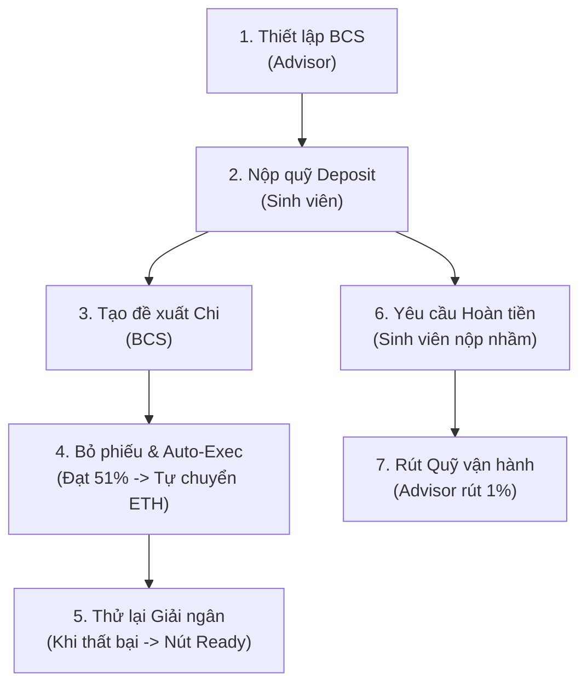

# HƯỚNG DẪN TRIỂN KHAI THỬ NGHIỆM PROJECTCORE LÊN SEPOLIA TESTNET (FIX 14)

> [!IMPORTANT]
> **TÀI LIỆU HƯỚNG DẪN DÀNH CHO NGƯỜI DÙNG TỰ THỰC HIỆN TRÊN REMIX IDE VÀ METAMASK**  
> Tuân thủ quy tắc an toàn: Không chia sẻ private key, không gửi seed phrase, không sửa mã nguồn trước khi deploy. Mọi giao dịch blockchain phải do chính người dùng kiểm tra và ký xác nhận trên ví MetaMask.

---

## MỤC LỤC HƯỚNG DẪN

1. [Cấu hình kỹ thuật bắt buộc](#1-cấu-hình-kỹ-thuật-bắt-buộc)
2. [Bước 1: Chuẩn bị Ví MetaMask & Sepolia ETH](#bước-1-chuẩn-bị-ví-metamask--sepolia-eth)
3. [Bước 2: Đưa mã nguồn `ProjectCore.sol` vào Remix IDE](#bước-2-đưa-mã-nguồn-projectcoresol-vào-remix-ide)
4. [Bước 3: Cấu hình Compiler trên Remix IDE](#bước-3-cấu-hình-compiler-trên-remix-ide)
5. [Bước 4: Kết nối MetaMask với Remix IDE & Kiểm tra Constructor](#bước-4-kết-nối-metamask-với-remix-ide--kiểm-tra-constructor)
6. [Bước 5: Thực hiện Giao dịch Deploy trên Sepolia](#bước-5-thực-hiện-giao-dịch-deploy-trên-sepolia)
7. [Bước 6: Lấy Contract Address & Kiểm tra trên Etherscan](#bước-6-lấy-contract-address--kiểm-tra-trên-etherscan)
8. [Bước 7: Cập nhật Contract Address vào `web/index.html`](#bước-7-cập-nhật-contract-address-vào-webindexhtml)
9. [Bước 8: Kiểm tra Website kết nối hợp đồng mới](#bước-8-kiểm-tra-website-kết-nối-hợp-đồng-mới)
10. [Bước 9: Checklist Kiểm thử 7 Chức năng Cốt lõi on-chain](#bước-9-checklist-kiểm-thử-7-chức-năng-cốt-lõi-on-chain)

---

## 1. CẤU HÌNH KỸ THUẬT BẮT BUỘC

Toàn bộ quá trình biên dịch và triển khai phải tuân thủ chính xác các tham số đã đóng băng tại FIX 12 và FIX 13:

| Thành phần | Giá trị chỉ định chuẩn | Ghi chú kiểm tra |
| :--- | :--- | :--- |
| **Mạng Blockchain** | **Ethereum Sepolia Testnet** | Chain ID: `11155111` (Hex: `0xaa36a7`) |
| **Mã nguồn Contract** | [contracts/project/ProjectCore.sol](file:///d:/document/TDT/KTS-Class-Fund-K57/contracts/project/ProjectCore.sol) | 1,007 dòng mã nguồn nguyên bản |
| **Chuẩn ABI** | [scratch/audited_ProjectCore.abi](file:///d:/document/TDT/KTS-Class-Fund-K57/scratch/audited_ProjectCore.abi) | 83 entries (39 fns, 17 events, 25 errors) |
| **Solidity Compiler** | **`0.8.20`** (`v0.8.20+commit.a1b79de6`) | Chuẩn theo `AGENTS.md` |
| **Optimizer** | **Enabled = true** | Checkbox *Enable optimization* |
| **Optimizer Runs** | **200** | Tối ưu hóa chi phí gas |
| **EVM Version** | **Shanghai** | Hỗ trợ opcode `PUSH0` tiêu chuẩn |
| **Constructor Arguments**| **Không có tham số** (`inputs: []`) | `advisor = msg.sender` |

---

## BƯỚC 1: CHUẨN BỊ VÍ METAMASK & SEPOLIA ETH

### 1.1. Bật hiển thị mạng Testnet trên MetaMask:
1. Mở tiện ích mở rộng **MetaMask** trên trình duyệt.
2. Nhấp vào menu chọn mạng ở góc trên bên trái của MetaMask.
3. Nếu chưa thấy mạng Sepolia:
   - Vào **Cài đặt (Settings)** $\rightarrow$ **Nâng cao (Advanced)**.
   - Bật tùy chọn **Hiển thị các mạng thử nghiệm (Show test networks)** thành **ON**.
4. Chọn mạng: **Sepolia** (hoặc *Sepolia test network*).

### 1.2. Xác định Ví Cố vấn học tập (Advisor Wallet):
> [!WARNING]
> **QUY TẮC BẤT BIẾN:** Trong mã nguồn `ProjectCore.sol`, hàm khởi tạo quy định:
> ```solidity
> constructor() {
>     advisor = msg.sender;
> }
> ```
> Biến `advisor` có kiểu `immutable`. **Địa chỉ ví gửi giao dịch deploy sẽ vĩnh viễn trở thành Cố vấn học tập (Advisor) duy nhất của hợp đồng.**
> Hãy chắc chắn rằng tài khoản ví đang kích hoạt trên MetaMask chính là ví cá nhân mà bạn muốn giữ quyền Cố vấn học tập để quản lý nhân sự Ban cán sự và rút phí vận hành!

### 1.3. Chuẩn bị số dư Sepolia ETH:
- **Lượng gas ước tính cho giao dịch deploy:** $\approx 2,500,000 - 3,000,000$ gas.
- **Phí gas SepoliaETH cần thiết:** $\approx 0.005 - 0.015$ SepoliaETH (tùy thuộc vào BaseFee của mạng tại thời điểm gửi).
- **Khuyến nghị:** Ví deploy cần có tối thiểu **$\ge 0.05$ SepoliaETH** để đảm bảo giao dịch không bị gián đoạn.
- **Các vòi nhận Sepolia ETH miễn phí (Faucet):**
  - [Google Cloud Web3 Sepolia Faucet](https://cloud.google.com/application/web3/faucet/ethereum/sepolia) (Nhận 0.05 ETH/ngày)
  - [Alchemy Sepolia Faucet](https://www.alchemy.com/faucets/ethereum-sepolia) (Nhận 0.1 ETH/ngày)
  - [QuickNode Sepolia Faucet](https://faucet.quicknode.com/ethereum/sepolia)
  - [Sepolia PoW Faucet](https://sepolia-faucet.pk910.de/) (Đào ETH testnet trực tiếp qua trình duyệt)

---

## BƯỚC 2: ĐƯA MÃ NGUỒN `PROJECTCORE.SOL` VÀO REMIX IDE

1. Truy cập trình soạn thảo trực tuyến chính thức của Ethereum Foundation:  
   👉 **[https://remix.ethereum.org](https://remix.ethereum.org)**
2. Tại bảng điều khiển bên trái, mở thư mục **File explorer** (icon thư mục trên cùng).
3. Trong thư mục `contracts/`, bấm vào icon **New File** (tạo file mới) và đặt tên:
   ```text
   ProjectCore.sol
   ```
4. Mở tệp [contracts/project/ProjectCore.sol](file:///d:/document/TDT/KTS-Class-Fund-K57/contracts/project/ProjectCore.sol) trên máy tính:
   - Chọn toàn bộ mã nguồn (`Ctrl + A`).
   - Sao chép toàn bộ (`Ctrl + C`).
5. Quay lại tab `ProjectCore.sol` trên Remix IDE và dán vào (`Ctrl + V`).
6. **Lưu ý an toàn:** Giữ nguyên 100% nội dung, không sửa đổi bất kỳ ký tự nào.

---

## BƯỚC 3: CẤU HÌNH COMPILER TRÊN REMIX IDE

1. Nhấp vào tab **Solidity Compiler** (icon thứ 3 từ trên xuống ở thanh công cụ góc trái).
2. Tại mục **COMPILER**:
   - Mở dropdown và chọn phiên bản: **`0.8.20+commit.a1b79de6`**.
3. Nhấp mở rộng mục **Advanced Configurations**:
   - Tích chọn checkbox: **Enable optimization** (Bật tối ưu hóa).
   - Nhập số runs: **`200`**.
   - Mục **EVM VERSION**: Nhấp chọn **`shanghai`**.
4. Nhấn nút xanh **Compile ProjectCore.sol** (hoặc nhấn phím tắt `Ctrl + S`).
5. **Kiểm tra kết quả:**
   - Xuất hiện biểu tượng **tích xanh** bên cạnh icon Solidity Compiler.
   - Tại mục *Contract* bên dưới, hiển thị hợp đồng: `ProjectCore (ProjectCore.sol)`.
   - Không xuất hiện bất kỳ thông báo lỗi màu đỏ (0 Errors, 0 Warnings).

---

## BƯỚC 4: KẾT NỐI METAMASK VỚI REMIX IDE & KIỂM TRA CONSTRUCTOR

1. Chuyển sang tab **Deploy & Run Transactions** (icon thứ 4 ở thanh công cụ góc trái - hình logo Ethereum với mũi tên).
2. Tại mục **ENVIRONMENT**:
   - Nhấp vào dropdown và chọn: **`Injected Provider - MetaMask`**.
3. **Popup MetaMask xuất hiện:**
   - MetaMask sẽ yêu cầu cấp quyền kết nối trang web `remix.ethereum.org`.
   - Người dùng kiểm tra địa chỉ ví hiển thị $\rightarrow$ Bấm **Tiếp theo (Next)** $\rightarrow$ Bấm **Kết nối (Connect)**.
4. **Kiểm tra xác nhận các thông số trên Remix:**
   - **Network:** Hiển thị `Sepolia (11155111) network`.
   - **Account:** Hiển thị đúng địa chỉ ví Advisor của bạn cùng số dư Sepolia ETH.
   - **Contract:** Chọn đúng `ProjectCore - contracts/ProjectCore.sol` trong dropdown.
5. **Kiểm tra Constructor:**
   - Quan sát nút màu cam **Deploy**: Phía bên cạnh hoặc bên dưới **KHÔNG CÓ ô nhập đối số** (vì constructor không nhận tham số).

---

## BƯỚC 5: THỰC HIỆN GIAO DỊCH DEPLOY TRÊN SEPOLIA

1. Nhấn nút màu cam **Deploy** trên Remix IDE.
2. **Popup MetaMask xuất hiện để người dùng xác nhận giao dịch:**
   - **Loại giao dịch:** Triển khai hợp đồng (Contract Deployment).
   - **Mạng kết nối:** Ethereum Sepolia Testnet.
   - **Phí mạng ước tính (Estimated gas fee):** Thường dao động từ ~0.005 đến 0.015 ETH.
   - **Tổng chi phí (Total):** Bằng đúng khoản phí gas (vì không gửi kèm ETH khi deploy).
3. **Thao tác của người dùng:**  
   - Kiểm tra kỹ các thông số.
   - Nhấn nút **Xác nhận (Confirm)** trên MetaMask.
4. **Chờ đợi xác nhận:**
   - Giao dịch được phát lên mạng Sepolia (mất khoảng 10 - 20 giây để được thợ đào đóng block).
   - Cửa sổ Terminal phía dưới Remix sẽ in ra dòng thông báo màu xanh:
     ```text
     [block: ...] transaction mined and execution succeed.
     creation of ProjectCore pending...
     ```

---

## BƯỚC 6: LẤY CONTRACT ADDRESS & KIỂM TRA TRÊN ETHERSCAN

1. **Lấy địa chỉ hợp đồng mới:**
   - Trong Remix, tại tab *Deploy & Run Transactions*, cuộn xuống mục **Deployed Contracts** (ở góc dưới bên trái).
   - Bạn sẽ thấy mục: `PROJECTCORE AT 0x... (MEMORY)`.
   - Nhấp vào biểu tượng **Copy** (hình 2 trang giấy xếp chồng) bên cạnh tên contract để sao chép địa chỉ hợp đồng mới (ví dụ: `0x1234...abcd`).
2. **Kiểm tra trạng thái on-chain trên Sepolia Etherscan:**
   - Mở trình duyệt và truy cập:
     ```text
     https://sepolia.etherscan.io/address/<DIA_CHI_CONTRACT_MOI>
     ```
   - Xác nhận:
     * Dòng **Contract Creator** hiển thị đúng địa chỉ ví MetaMask của bạn.
     * Giao dịch tạo hợp đồng có trạng thái **Success**.
     * Mục **Balance** khởi đầu là `0 ETH`.

---

## BƯỚC 7: CẬP NHẬT CONTRACT ADDRESS VÀO `WEB/INDEX.HTML`

Sau khi đã có địa chỉ hợp đồng mới, bạn mở file mã nguồn giao diện để kết nối:

1. Mở file [web/index.html](file:///d:/document/TDT/KTS-Class-Fund-K57/web/index.html) bằng trình soạn thảo mã nguồn.
2. Tìm đến khối `const CONFIG =` (khoảng dòng 5635 - 5644):
   ```javascript
   // THAY ĐỔI TẠI ĐÂY:
   const CONFIG = {
     chainId: 11155111,
     chainIdHex: "0xaa36a7",
     chainName: "Ethereum Sepolia Testnet",
     blockExplorer: "https://sepolia.etherscan.io",
     // Thay địa chỉ cũ bằng địa chỉ contract mới vừa deploy:
     defaultContractAddress: "0x<DIA_CHI_CONTRACT_MOI_VUA_DEPLOY>",
     contractAddress: "0x<DIA_CHI_CONTRACT_MOI_VUA_DEPLOY>"
   };
   ```
3. Lưu tệp [web/index.html](file:///d:/document/TDT/KTS-Class-Fund-K57/web/index.html).

---

## BƯỚC 8: KIỂM TRA WEBSITE KẾT NỐI HỢP ĐỒNG MỚI

1. Mở file [web/index.html](file:///d:/document/TDT/KTS-Class-Fund-K57/web/index.html) trên trình duyệt (hoặc qua Live Server / Local HTTP Server).
2. **Cơ chế Tự động Đồng bộ (Auto-Migration) kích hoạt:**
   - Website được trang bị cơ chế tự phát hiện địa chỉ mới. Cửa sổ Terminal góc dưới sẽ in thông báo:
     ```text
     [Hệ thống] Phát hiện phiên bản hợp đồng mới từ dự án: 0x... Tự động đồng bộ...
     ```
   - Toàn bộ cache người nộp cũ trong LocalStorage được dọn dẹp sạch sẽ.
3. **Kiểm tra giao diện người dùng:**
   - Nhãn địa chỉ contract trên thanh Sidebar chân trang hiển thị đúng địa chỉ mới (rút gọn).
   - Bấm nút **"Kết nối MetaMask"** ở góc trên bên phải.
   - Nếu kết nối bằng ví Deployer $\rightarrow$ Huy hiệu tài khoản hiển thị: **"Cố vấn học tập" (Advisor)**.
   - Các trường chỉ số: Quỹ lớp chính (`0.0000 ETH`), Quỹ vận hành (`0.0000 ETH`), Giữ chỗ chi (`0.0000 ETH`).

---

## BƯỚC 9: CHECKLIST KIỂM THỬ 7 CHỨC NĂNG CỐT LÕI ON-CHAIN

Thực hiện kiểm thử luồng nghiệp vụ thực tế theo thứ tự chuẩn mực:



### Bảng kịch bản kiểm thử chi tiết:

| STT | Chức năng kiểm thử | Ví thực hiện | Thao tác trên Giao diện | Kết quả mong đợi on-chain | Phê duyệt MetaMask |
| :---: | :--- | :---: | :--- | :--- | :---: |
| **1** | **Cấu hình Ban cán sự (setBCSMember)** | Ví Advisor | Vào mục *Cố vấn học tập* $\rightarrow$ Nhập địa chỉ ví BCS $\rightarrow$ Bấm **Kích hoạt BCS**. | Event `BCSMemberUpdated` phát ra. Số lượng `activeBCSCount` tăng lên 1 (cần kích hoạt 2-3 ví BCS). | Ký giao dịch `setBCSMember` |
| **2** | **Nộp tiền vào quỹ (Deposit)** | Ví Sinh viên | Nhập số tiền `0.02` ETH $\rightarrow$ Bấm nút **"Nạp tiền vào quỹ"**. | `classFundBalance` tăng `0.0198 ETH` (99%), `adminFeePool` tăng `0.0002 ETH` (1%). | Ký chuyển 0.02 ETH vào contract |
| **3** | **Tạo đề xuất chi (createSpendRequest)** | Ví BCS 1 | Vào tab BCS $\rightarrow$ Nhập ví người nhận, số tiền `0.005` ETH, nội dung chi $\rightarrow$ Bấm **Tạo đề xuất**. | Đề xuất #1 tạo thành công ở trạng thái `Pending`. `reservedSpendAmount` giữ chỗ `0.005 ETH`. | Ký giao dịch `createSpendRequest` |
| **4** | **Biểu quyết & Auto-Execution** | Ví BCS 1 & BCS 2 | - BCS 1 bấm **Đồng ý**.<br>- Chuyển sang ví BCS 2 bấm **Đồng ý**. | Khi BCS 2 vote đạt $\ge 51\%$, giao dịch **tự động chuyển 0.005 ETH** cho người nhận. Event `SpendRequestExecuted` phát ra, trạng thái chuyển `Executed`. | Ký giao dịch `voteSpendRequest` |
| **5** | **Thử lại Giải ngân (Manual Retry)** | Ví BCS | Tạo đề xuất chi cho hợp đồng từ chối ETH $\rightarrow$ BCS vote đạt 51% $\rightarrow$ Tự động chuyển thất bại $\rightarrow$ Đề xuất chuyển về `Ready` $\rightarrow$ Bấm nút **"Giải ngân"** thủ công. | Lệnh thử lại bị revert an toàn, tiền quỹ không bị mất, đề xuất giữ nguyên trạng thái `Ready` để thử lại sau. | Ký giao dịch `executeSpendRequest` |
| **6** | **Yêu cầu Hoàn tiền (Refund Request)** | Ví Sinh viên | Vào ô Sinh viên $\rightarrow$ Nhập số tiền hoàn `0.005` ETH và lý do $\rightarrow$ Bấm **Gửi yêu cầu**. Sau đó BCS biểu quyết đạt 51%. | Tiền hoàn `0.005 ETH` tự động hoàn trả về ví sinh viên. Số tiền đóng góp của sinh viên được trừ tương ứng. | Ký giao dịch `createRefundRequest` & `voteRefundRequest` |
| **7** | **Rút phí Quỹ vận hành (Withdraw Fee)** | Ví Advisor | Vào ô Cố vấn học tập $\rightarrow$ Nhập số tiền `0.0002` ETH $\rightarrow$ Bấm **Rút phí vận hành**. | `adminFeePool` trừ `0.0002 ETH`, ví Advisor nhận được `0.0002 ETH` để bù đắp chi phí gas. | Ký giao dịch `withdrawAdminFee` |

---

## 10. TỔNG KẾT & LƯU Ý AN TOÀN

1. **Bảo mật tuyệt đối:** Tuyệt đối không bao giờ chia sẻ private key hay 12 từ khóa khôi phục (seed phrase) cho bất kỳ ai hoặc bất kỳ công cụ AI nào.
2. **Kiểm tra kỹ mạng:** Luôn quan sát thanh thông báo mạng của MetaMask đảm bảo đang ở **Sepolia Testnet** trước khi bấm bất kỳ nút bấm ký nào.
3. **Lưu trữ bằng chứng:** Sau khi hoàn tất triển khai và kiểm thử, hãy chụp ảnh màn hình giao diện web hiển thị địa chỉ contract mới và lưu lại các đường link giao dịch trên Etherscan để phục vụ báo cáo bài tập lớn môn học.
