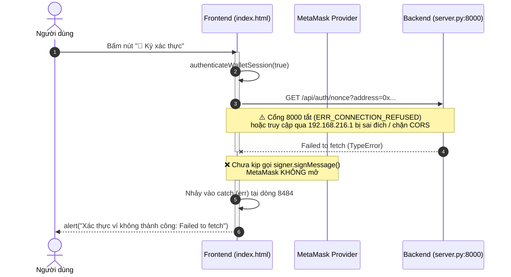

# FIX 15 — BÁO CÁO CHẨN ĐOÁN LỖI XÁC THỰC VÍ "FAILED TO FETCH"
**Dự án**: KTS-Class-Fund-K57 (ECO2432)  
**Tập tin chẩn đoán**: `scratch/FIX15_WALLET_AUTH_DIAGNOSIS.md`  
**Ngày thực hiện**: 02/11/2026  
**Chế độ**: Chỉ điều tra, phân tích nguyên nhân và đề xuất phương án (Chưa can thiệp sửa mã nguồn).

---

## 1. TỔNG QUAN HIỆN TƯỢNG VÀ KẾT QUẢ ĐIỀU TRA

Khi người dùng nhấn nút **"🔑 Ký xác thực"** trên giao diện website KTS-Class-Fund-K57, giao diện ném cảnh báo lỗi:
```text
Xác thực ví không thành công: Failed to fetch
```
Console trình duyệt ghi nhận lỗi tại `web/index.html:8485`.

### Tóm tắt các phát hiện cốt lõi:
1. **Lỗi xảy ra trước khi MetaMask mở cửa sổ ký**: Ngay bước đầu tiên của hàm `authenticateWalletSession`, frontend gọi `fetch("http://localhost:8000/api/auth/nonce?address=...")` để xin mã thử thách (challenge nonce). Cuộc gọi này thất bại ngay lập tức, do đó lệnh gọi `signer.signMessage(...)` chưa bao giờ được kích hoạt.
2. **Backend Python (`PORT 8000`) hiện KHÔNG CHẠY**: Tiến trình máy chủ tĩnh Node.js phục vụ frontend đang chạy ở cổng 3000 (PID 19300), nhưng cổng 8000 hoàn toàn không có tiến trình nào lắng nghe (`ERR_CONNECTION_REFUSED`).
3. **Hardcode `http://localhost:8000` ở Frontend**: Toàn bộ các API xác thực và danh bạ trong `web/index.html` đều trỏ cứng tới `http://localhost:8000`. Khi mở web qua IP nội bộ `192.168.216.1:3000` từ thiết bị khác (hoặc điện thoại/máy ảo), trình duyệt của thiết bị đó sẽ tìm cổng 8000 trên chính thiết bị đó chứ không gọi về máy chủ.
4. **Cấu hình CORS ở Backend chưa hỗ trợ IP nội bộ**: Danh sách `DEV_ALLOWED_ORIGINS` trong `backend/server.py` chỉ khai báo `localhost` và `127.0.0.1`. Ngay cả khi Backend chạy, request từ `http://192.168.216.1:3000` vẫn sẽ bị từ chối do thiếu header `Access-Control-Allow-Origin`.
5. **Bất đồng bộ cấu trúc dữ liệu phiên (Data Contract Mismatch)**: Backend trả về `loginData.role`, nhưng Frontend lại kiểm tra `loginData.session.role`. Khi khắc phục được kết nối mạng, người dùng ký thành công thì hệ thống vẫn sẽ gán nhầm vai trò là `guest`.

---

## 2. KẾT QUẢ ĐIỀU TRA THEO 9 NHIỆM VỤ YÊU CẦU

### Nhiệm vụ 1: Đọc đoạn code quanh dòng 8485 trong `web/index.html` và xác định hàm xử lý
- **Hàm xử lý**: `async function authenticateWalletSession(interactive = true)` (được định nghĩa từ dòng 8413 đến dòng 8501).
- **Phần tử gắn sự kiện**:
  - Nút bấm chính trên thanh điều hướng topbar:
    ```html
    <!-- Dòng 4087-4090 -->
    <button class="btn btn-warning btn-sm" id="btnVerifyWalletAuth"
      style="display:none; padding:4px 10px; font-size:0.8rem;" onclick="authenticateWalletSession(true)"
      title="Ký thông điệp xác thực bảo mật để mở khóa vai trò BCS/Cố vấn và bảo vệ thông tin sinh viên">
      🔑 Ký xác thực
    </button>
    ```
  - Các nút phụ hiển thị trong Modal danh bạ và khung cảnh báo (Dòng 8237, 8605): `onclick="authenticateWalletSession(true)"`.
  - Tự động gọi ngầm khi ví vừa kết nối thành công:
    ```javascript
    // Dòng 8357
    await authenticateWalletSession(false);
    ```
- **Khối `catch (err)` tại dòng 8484-8500**:
  ```javascript
  8484: } catch (err) {
  8485:   console.warn("Lỗi xác thực ví:", err);
  8486:   logToTerminal(`[Xác thực ví] ⚠️ Chưa xác thực: ${err.message}`);
  8487:   clearSensitiveClientData(true);
  8488:   const bVerify = document.getElementById("btnVerifyWalletAuth");
  8489:   if (bVerify && userAddress) bVerify.style.display = "inline-flex";
  8490: 
  8491:   if (interactive) {
  8492:     if (err.code === 4001 || (err.message && err.message.toLowerCase().includes("user rejected"))) {
  8493:       alert("Bạn đã hủy ký xác thực MetaMask. Giao diện trở về chế độ khách vãng lai an toàn (Chỉ xem dữ liệu công khai).");
  8494:     } else {
  8495:       alert("Xác thực ví không thành công: " + err.message);
  8496:     }
  8497:   }
  8498:   return false;
  8499: }
  ```
  Khi `fetch()` thất bại ở tầng mạng, trình duyệt sinh ra ngoại lệ `TypeError: Failed to fetch`. `err.message` bằng `"Failed to fetch"`, dẫn đến thông báo `alert("Xác thực ví không thành công: Failed to fetch")`.

---

### Nhiệm vụ 2 & 3: Các lệnh `fetch()` trong luồng xác thực và URL API thực tế
Toàn bộ luồng xác thực và hậu xác thực thực hiện các lệnh gọi `fetch()` sau:

| STT | Tập tin & Dòng | Phương thức | URL API thực tế đang gọi | Mục đích |
|---|---|---|---|---|
| 1 | `web/index.html:8421` | `GET` | `http://localhost:8000/api/auth/nonce?address=${encodeURIComponent(userAddress)}` | Yêu cầu Backend phát sinh Challenge Nonce |
| 2 | `web/index.html:8434` | `POST` | `http://localhost:8000/api/auth/login` | Gửi chữ ký mật mã (address, nonce, signature) để xác thực và nhận JWT/Session Token |
| 3 | `web/index.html:8510` | `GET` | `http://localhost:8000/api/roster/check?address=${encodeURIComponent(address)}` | Gọi trong `checkMyStudentIdentity` sau khi đăng nhập để lấy hồ sơ sinh viên |
| 4 | `web/index.html:8532` | `GET` | `http://localhost:8000/api/roster` | Gọi trong `loadClassRoster` để nạp danh bạ lớp (chỉ mở khóa cho BCS/Cố vấn) |
| 5 | `web/index.html:8173` | `POST` | `http://localhost:8000/api/auth/logout` | Hủy phiên làm việc trên server khi ngắt kết nối ví hoặc đổi ví |

*Nhận xét*: Tất cả các URL đều bị gán cứng tiền tố `http://localhost:8000`.

---

### Nhiệm vụ 4 & 5: Endpoint tương ứng trong Backend và đối chiếu sự tồn tại
Trong `backend/server.py`, lớp `AIChatRequestHandler` (kế thừa từ `BaseHTTPRequestHandler`) đã định nghĩa đầy đủ các endpoint phục vụ luồng này:

1. **`GET /api/auth/nonce`** (Dòng 458-485 trong `backend/server.py`):
   - Đọc query param `address`.
   - Sinh chuỗi ngẫu nhiên `nonce = secrets.token_hex(16)`.
   - Lưu vào `ACTIVE_NONCES` với thời hạn 300 giây (5 phút).
   - Trả về JSON: `{ success: true, address, nonce, message, expiresIn: 300 }`.
2. **`POST /api/auth/login`** (Dòng 609-759 trong `backend/server.py`):
   - Đọc JSON `{ address, nonce, signature }`.
   - Kiểm tra tính hợp lệ và thời hạn của Nonce trong `ACTIVE_NONCES`.
   - Giải mã chữ ký qua `Account.recover_message(msg_encoded, signature=signature)` từ thư viện `eth_account`.
   - Tiêu thụ Nonce ngay lập tức (chống tấn công Replay Attack).
   - Tra cứu vai trò (`advisor`, `bcs`, `student`, `guest`) qua `resolve_wallet_role()`.
   - Cấp phiên làm việc `ACTIVE_SESSIONS[token]` có hạn 3600 giây (1 giờ).
3. **`GET /api/auth/session`** (Dòng 487-506): Kiểm tra token hiện hành.
4. **`POST /api/auth/logout`** (Dòng 761-784): Hủy token.
5. **`GET /api/roster/check`** (Dòng 568-599): Kiểm tra danh tính sinh viên theo ví.

**Kết luận**: Backend **CÓ ĐẦY ĐỦ** toàn bộ các endpoint mà frontend yêu cầu. Lỗi không phải do thiếu endpoint hay sai đường dẫn URL phía máy chủ.

---

### Nhiệm vụ 6: Trạng thái Backend thực tế, cổng, cách khởi động và biến môi trường
Thực hiện quét hệ thống trực tiếp qua terminal PowerShell:

1. **Kiểm tra cổng lắng nghe (TCP Ports)**:
   ```powershell
   Get-NetTCPConnection -LocalPort 3000, 8000
   ```
   **Kết quả thực tế**:
   ```text
   LocalAddress  LocalPort  State   OwningProcess
   ------------  ---------  -----   -------------
   ::            3000       Listen  19300
   ```
   - Cổng 3000: Đang lắng nghe bởi tiến trình PID 19300 (`node.exe` - Web server static).
   - Cổng 8000: **HOÀN TOÀN TRỐNG**, không có tiến trình nào lắng nghe.
2. **Kiểm tra tiến trình Python**:
   ```powershell
   Get-Process -Name python
   ```
   **Kết quả thực tế**: Không có bất kỳ tiến trình Python nào đang chạy trên hệ thống. (Python đã cài đặt: phiên bản `3.13.7`).
3. **Cấu hình cổng trong Backend**:
   - Tệp: `backend/server.py`, dòng 63-64:
     ```python
     HOST = "0.0.0.0"
     PORT = 8000
     ```
4. **Cách khởi động Backend**:
   - Mở terminal và chạy lệnh:
     ```bash
     python backend/server.py
     ```
   - Máy chủ sẽ lắng nghe tại `http://0.0.0.0:8000` (truy cập được từ cả `localhost:8000` lẫn IP LAN `192.168.216.1:8000`).
5. **Các biến môi trường liên quan (trong `.env`)**:
   - `GEMINI_API_KEY`: Dùng cho trợ lý AI (`ai_service.py`).
   - `ADVISOR_ADDRESS`: Địa chỉ ví cố vấn học tập để phân quyền (nếu ví người dùng trùng địa chỉ này, quyền sẽ là `advisor`).
   - `ENV`: Môi trường hoạt động (`development` hoặc `production`).

---

### Nhiệm vụ 7: Cấu hình CORS, localhost, IP nội bộ và HTTP/HTTPS

#### A. Cấu hình CORS hiện tại trong `backend/server.py`
Tại các dòng 89-98 và 407-424 của `backend/server.py`:
```python
DEV_ALLOWED_ORIGINS = {
    "http://localhost:3000",
    "http://127.0.0.1:3000",
    "http://localhost:5500",
    "http://127.0.0.1:5500",
    "http://localhost:5173",
    "http://127.0.0.1:5173",
    "http://localhost:8000",
    "http://127.0.0.1:8000",
}

def _send_cors_headers(self):
    origin = self.headers.get("Origin")
    if not origin:
        return
    is_allowed = False
    if origin in DEV_ALLOWED_ORIGINS:
        is_allowed = True
    elif origin == "null" and not IS_PRODUCTION:
        is_allowed = True

    if is_allowed:
        self.send_header("Access-Control-Allow-Origin", origin)
        self.send_header("Access-Control-Allow-Methods", "GET, POST, OPTIONS")
        self.send_header("Access-Control-Allow-Headers", "Content-Type, Authorization")
        self.send_header("Access-Control-Max-Age", "86400")
```

#### B. Phân tích tác động với Localhost (`http://localhost:3000`)
- `http://localhost:3000` **nằm trong whitelist** `DEV_ALLOWED_ORIGINS`.
- Khi người dùng mở bằng `localhost:3000` mà vẫn bị `Failed to fetch`, nguyên nhân duy nhất là **tiến trình máy chủ cổng 8000 chưa được bật** (`ERR_CONNECTION_REFUSED`).

#### C. Phân tích tác động với IP nội bộ (`http://192.168.216.1:3000`)
Khi mở website bằng `http://192.168.216.1:3000`, có **2 tầng lỗi đồng thời**:
1. **Lệch điểm đến mạng (Mismatched Destination)**:
   - Frontend gọi cứng `http://localhost:8000`.
   - Nếu truy cập từ thiết bị khác trong mạng LAN, `localhost` trỏ về chính thiết bị đó chứ không trỏ về máy chủ phát web `192.168.216.1`.
2. **CORS Blocked (Vi phạm chính sách CORS)**:
   - Ngay cả khi người dùng mở trình duyệt trên chính máy host qua `http://192.168.216.1:3000`, trình duyệt sẽ đính kèm header: `Origin: http://192.168.216.1:3000`.
   - `http://192.168.216.1:3000` **KHÔNG CÓ** trong danh sách `DEV_ALLOWED_ORIGINS`.
   - Hàm `_send_cors_headers()` sẽ bỏ qua và không gửi `Access-Control-Allow-Origin`.
   - Trình duyệt sẽ chặn phản hồi với lỗi CORS Policy, biểu hiện trong JavaScript bằng ngoại lệ `TypeError: Failed to fetch`.

#### D. HTTP / HTTPS
- Cả website frontend (cổng 3000) và backend API (cổng 8000) đều đang sử dụng giao thức `http://` thuần.
- Không có lỗi Mixed Content (HTTPS gọi HTTP) ở môi trường phát triển hiện tại.

---

### Nhiệm vụ 8: Thời điểm xảy ra lỗi so với cửa sổ ký của MetaMask
Xét thứ tự thực thi trong `authenticateWalletSession`:
```javascript
// 1. Bước 1: Xin Nonce từ Backend (Dòng 8421)
logToTerminal("[Xác thực ví] Đang yêu cầu mã thử thách (nonce) từ máy chủ bảo mật...");
const nonceRes = await fetch(`http://localhost:8000/api/auth/nonce?address=${encodeURIComponent(userAddress)}`);

// 2. Bước 2: Ký trên MetaMask (Dòng 8431)
logToTerminal("[Xác thực ví] Vui lòng ký thông điệp trên MetaMask (Không tốn phí gas)...");
const signature = await signer.signMessage(nonceData.message);
```

**Khẳng định**: Lỗi xảy ra **TRƯỚC KHI** MetaMask mở cửa sổ ký.  
Lệnh `fetch()` ở Bước 1 thất bại ngay lập tức, luồng thực thi văng thẳng vào khối `catch (err)` ở dòng 8484. Dòng 8431 (`signer.signMessage`) **chưa bao giờ được thực thi**, vì thế cửa sổ popup của MetaMask không thể xuất hiện.

---

### Nhiệm vụ 9: Tính nhất quán của cơ chế Nonce, Chữ ký và Xác minh giữa Frontend và Backend

#### A. Tính nhất quán về mật mã (Cryptographic Compatibility): ĐÃ TƯƠNG THÍCH HOÀN TOÀN
- **Định dạng thông điệp**:
  Hàm `generate_auth_message(address, nonce)` trên server (dòng 120-126):
  ```text
  KTS-Class-Fund-K57 Authentication
  Address: {address.lower()}
  Nonce: {nonce}
  Mục đích: Xác thực quyền sở hữu ví và đăng nhập hệ thống KTS-Class-Fund-K57.
  Lưu ý: Thao tác này không tốn phí Gas và không gửi transaction on-chain.
  ```
  Thông điệp này được server tạo ra và gửi nguyên bản về client trong trường `nonceData.message`.
- **Phương thức ký client**:
  `signer.signMessage(nonceData.message)` của `ethers.js` đóng gói theo chuẩn **EIP-191** (`\x19Ethereum Signed Message:\n<length><message>`).
- **Phương thức xác minh server**:
  Backend dùng `encode_defunct(text=expected_msg)` và `Account.recover_message(...)` từ `eth_account`, hoàn toàn tương thích 1:1 với EIP-191.
- **Tính an toàn Nonce**:
  - Nonce có thời hạn 5 phút.
  - Được bảo vệ bởi khóa đa luồng `AUTH_MUTEX`.
  - Hủy ngay sau khi sử dụng một lần (chống Replay Attack).

#### B. Bất nhất về cấu trúc dữ liệu trả về (Data Contract Mismatch): CÓ LỖI TIỀM ẨN
Hãy so sánh dữ liệu trả về từ Backend và mã xử lý tại Frontend:

- **Phía Backend trả về** (`backend/server.py:749-758`):
  ```json
  {
    "success": true,
    "message": "Xác thực chữ ký ví thành công.",
    "token": "...",
    "address": "0x...",
    "role": "bcs",
    "isAdvisor": false,
    "isBcs": true,
    "expiresIn": 3600
  }
  ```
- **Phía Frontend giải mã** (`web/index.html:8453-8454`):
  ```javascript
  const verifiedRole = loginData.session ? loginData.session.role : "guest";
  const roleTitle = loginData.session ? loginData.session.roleTitle : "";
  ```
  - Backend trả về `role` ở cấp ngoài cùng (`loginData.role`), không có đối tượng con `loginData.session`.
  - Hậu quả: `loginData.session` là `undefined`. Biến `verifiedRole` sẽ luôn nhận giá trị mặc định `"guest"`.
  - Ngay cả khi kết nối mạng được sửa và người dùng ký ví thành công, hệ thống vẫn sẽ thông báo vai trò khách vãng lai và không mở khóa quyền Ban cán sự / Cố vấn!

---

## 3. BẢNG TỔNG HỢP NGUYÊN NHÂN VÀ CƠ CHẾ SINH LỖI



---

## 4. HƯỚNG DẪN KHẮC PHỤC CỤ THỂ (PHÂN ĐỊNH FRONTEND & BACKEND)

### 4.1. Khắc phục ngay lập tức để tiếp tục sử dụng (Vận hành)
Khởi động dịch vụ Backend trong một cửa sổ terminal riêng:
```bash
python backend/server.py
```
Sau khi thấy thông báo:
```text
🚀 KTS-Class-Fund Backend (Auth Protected) đang chạy tại http://localhost:8000
```
Mở trình duyệt tại `http://localhost:3000` và nhấn lại nút "🔑 Ký xác thực".

---

### 4.2. Khắc phục triệt để phía Backend (`backend/server.py`)

#### Bước B1: Hỗ trợ linh hoạt Origin IP nội bộ cho CORS
Cập nhật cơ chế xác thực Origin trong `AIChatRequestHandler._send_cors_headers` để hỗ trợ dải IP mạng cục bộ (LAN IP như `192.168.x.x`, `10.x.x.x`):
- Thay vì chỉ so khớp cứng trong `DEV_ALLOWED_ORIGINS`, trong chế độ phát triển (`not IS_PRODUCTION`), cho phép các origin dạng `http://192.168.*:*` hoặc so khớp linh hoạt dựa trên `Host` của server.

#### Bước B2: Đồng bộ hóa cấu trúc dữ liệu phản hồi `/api/auth/login`
Bổ sung `roleTitle` và gói `session` tương thích ngược trong kết quả trả về của `POST /api/auth/login`:
```python
# Cung cấp cả cấu trúc phẳng lẫn cấu trúc session lồng nhau để frontend đọc an toàn
session_payload = {
    "token": token,
    "address": claimed_addr,
    "role": role,
    "roleTitle": "Cố vấn học tập" if role == "advisor" else ("Ban cán sự" if role == "bcs" else "Sinh viên"),
    "isAdvisor": is_advisor,
    "isBcs": is_bcs,
    "expiresIn": SESSION_LIFETIME_SEC
}
self._send_json(200, {
    "success": True,
    "message": "Xác thực chữ ký ví thành công.",
    "session": session_payload,
    **session_payload
})
```

---

### 4.3. Khắc phục triệt để phía Frontend (`web/index.html`)

#### Bước F1: Loại bỏ URL cứng `http://localhost:8000`, chuyển sang cấu hình động
Xác định base URL của API dựa trên vị trí hiện tại của trình duyệt (`window.location.hostname`):
```javascript
const BACKEND_BASE_URL = (function() {
  const host = window.location.hostname || "localhost";
  const protocol = window.location.protocol === "https:" ? "https:" : "http:";
  // Nếu mở bằng file:// hoặc localhost, dùng localhost:8000; nếu mở bằng IP LAN (192.168.x.x), trỏ API về cùng IP LAN cổng 8000
  return `${protocol}//${host}:8000`;
})();
```
Thay thế tất cả các chuỗi `http://localhost:8000` tại các dòng 8173, 8421, 8434, 8510, 8532, 9059, 10306 bằng `BACKEND_BASE_URL`.

#### Bước F2: Xử lý tương thích việc đọc vai trò tại `authenticateWalletSession`
Tại dòng 8453-8454:
```javascript
const verifiedRole = (loginData.session && loginData.session.role) || loginData.role || "guest";
const roleTitle = (loginData.session && loginData.session.roleTitle) || loginData.roleTitle || (verifiedRole === "advisor" ? "Cố vấn" : (verifiedRole === "bcs" ? "Ban cán sự" : "Sinh viên"));
```

#### Bước F3: Cải thiện thông báo lỗi khi Backend chưa bật
Tại khối `catch (err)` của `authenticateWalletSession`, kiểm tra nếu `err.message` chứa `"Failed to fetch"`, đưa ra gợi ý trực quan cho người dùng:
```text
"Không thể kết nối đến máy chủ bảo mật Backend (cổng 8000). Vui lòng đảm bảo máy chủ đã được khởi động bằng lệnh: python backend/server.py"
```

---

*Báo cáo được hoàn thành theo đúng nguyên tắc quy định: Độc lập điều tra, kiểm chứng bằng chứng thực tế, không can thiệp sửa đổi mã nguồn hoặc gửi giao dịch on-chain.*
